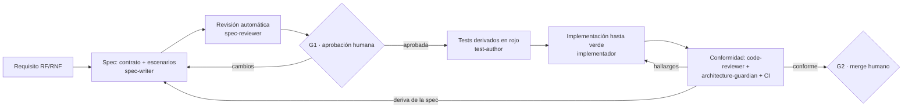
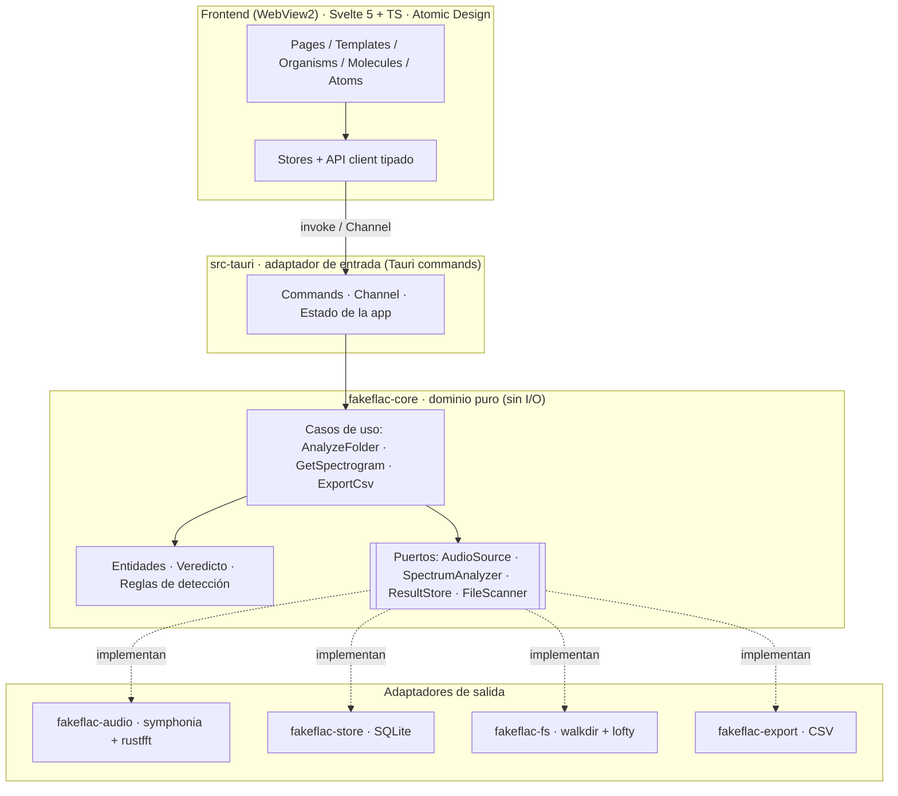
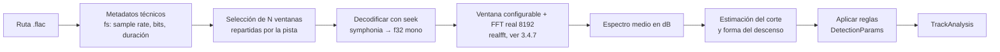
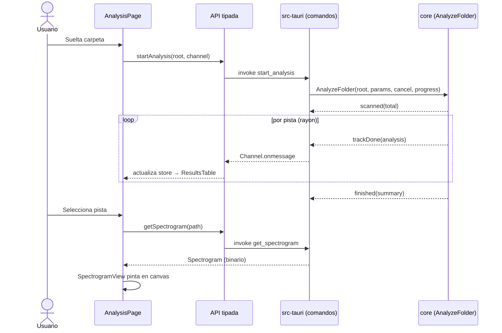
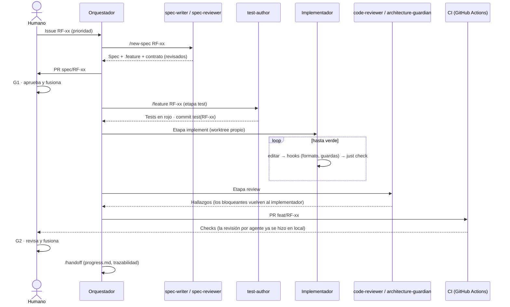
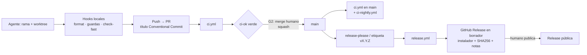

# FakeFlac

Aplicación de escritorio para detectar audio de calidad falsa —FLAC o WAV que proceden de un MP3/AAC, y MP3/M4A/Opus que proceden de un original con menos bitrate— en la línea de Fakin' The Funk. Formatos: **WAV, FLAC, MP3, M4A y Opus**. Stack: **Tauri v2 + Rust** en el backend y un frontend web.

**Modo de desarrollo: enteramente agéntico.** Specs, tests, código, documentación y automatización los escriben agentes de IA (Claude Code y sus subagentes) dentro de un arnés versionado en el propio repositorio. La persona responsable define la intención, aprueba specs y decisiones, y fusiona los cambios (ver 1.4 y 3.11).

> Ciclo de desarrollo en 6 fases: **1. Planificación** · **2. Análisis de requisitos** · **3. Diseño** · 4. Implementación (empieza por el hito **H0 · Arnés agéntico**) · 5. Pruebas · 6. Despliegue y mantenimiento.
> Este documento cubre las fases 1, 2 y 3.

---

# Fase 1 · Planificación

## 1.1 Visión y objetivo
Dar una respuesta rápida y fiable a la pregunta «¿este FLAC es lossless real?» para una carpeta entera, con una prueba visual (espectrograma) que respalde el veredicto.

**Resultado final:** una aplicación de escritorio para Windows, de aspecto y manejo similares a Fakin' The Funk (arrastrar archivos o carpetas, lista con veredicto por pista, espectro a la vista), distribuida como instalador desde las releases públicas del repositorio en GitHub (`C:\Workspaces\FakeFlac\` en local). Detalle en 3.14.

Objetivo de proceso: construir la aplicación de principio a fin con flujos agénticos (1.4), sin escribir código a mano, y dejar un arnés reutilizable que lo haga posible.

## 1.2 Problema
- Las descargas (p. ej. Soulseek) mezclan FLAC reales con transcodificaciones de MP3.
- Fakin' The Funk resuelve el problema, pero es una aplicación cerrada con interfaz gráfica, sin modo de línea de comandos y sin posibilidad de automatizarla.
- Una prueba rápida con `ffmpeg` + `numpy` funciona, pero no es cómoda ni muestra el espectrograma.

## 1.3 Alcance

**Dentro del alcance (v1)**
- Analizar una carpeta (recursiva) de archivos de audio en **WAV, FLAC, MP3, M4A y Opus** (RF-14).
- Para los formatos con pérdida, estimar el **bitrate real de origen** y detectar, por ejemplo, un MP3 a 320 kbps que procede de un original de 128 o 192 kbps (RF-15).
- Veredicto por pista: real, sospechoso o falso, con la frecuencia de corte estimada y, en formatos con pérdida, el bitrate declarado frente al estimado.
- Espectrograma por pista.
- Tabla de resultados con ordenación y filtros.
- Exportar resultados a CSV.

**Fuera del alcance (v1)**
- Reproductor de audio (la interfaz de referencia lo incluye; se reserva su sitio pero no entra en v1).
- Columnas de clipping y silencio, o enlaces a tiendas, que sí tiene la herramienta de referencia.
- Edición de etiquetas o renombrado de archivos.
- Búsqueda de metadatos en servicios externos o descargas.
- Otros sistemas operativos distintos de Windows (Tauri lo permitiría más adelante).

**Dentro del alcance del proyecto (no del producto)**
- El arnés de desarrollo agéntico del repositorio: `CLAUDE.md`, documentación de arquitectura para agentes, subagentes, skills, hooks, permisos e integración continua (hito H0).

## 1.4 Modelo de desarrollo: enteramente agéntico

El proyecto se construye **íntegramente con flujos agénticos**: agentes de IA escriben las specs, los tests, el código, la documentación y la automatización. La persona responsable no programa: **define la intención, aprueba specs y decisiones de arquitectura, y fusiona** los cambios.

Consecuencias para la planificación:
- **El arnés es un entregable.** Instrucciones (`CLAUDE.md`), documentación de arquitectura legible por agentes, subagentes, skills, hooks, permisos e integración continua se diseñan (3.11), se versionan en el repositorio y se construyen **antes** que el producto, en un hito propio: **H0 · Arnés agéntico**.
- **SDD pasa de buena práctica a interfaz con los agentes.** La spec es la orden de trabajo y los tests derivados de ella, el criterio objetivo de «terminado». Sin spec aprobada, un agente no tiene qué implementar.
- **La verificación tiene que ser automática.** Lo que el humano comprobaría a mano se convierte en un check ejecutable (tests, lint de capas, diferencias del contrato, trazabilidad), porque es lo único que un agente puede usar para saber si ha terminado.
- **El cuello de botella pasa a ser la revisión humana**, no la escritura de código: se planifica con PR pequeños y dos puertas de aprobación concretas (G1: spec; G2: merge).

| Quién | Hace | No hace |
|---|---|---|
| Responsable humano | Prioriza, aprueba specs y ADR (puerta **G1**), fusiona en `main` (puerta **G2**), aporta el criterio auditivo/visual en la calibración | Escribir código ni tests |
| Agente orquestador (sesión principal de Claude Code) | Planifica la tarea, delega en subagentes, integra el resultado y abre el PR | Fusionar ni aprobar sus propias specs |
| Subagentes especializados | Redactan specs, derivan tests, implementan, revisan y mantienen la documentación (3.11.4) | Salirse de su rol ni de su ámbito de escritura |
| CI | Autoridad final: ejecuta los mismos checks que los agentes (sin agentes propios, ADR-023) | — |

## 1.5 Stack propuesto

| Capa | Tecnología | Motivo |
|---|---|---|
| Shell de escritorio | Tauri v2 | Instalador pequeño, backend en Rust |
| Decodificación | `symphonia` | Pure Rust, sin depender de `ffmpeg` |
| FFT | `rustfft` | Rápido y sin dependencias nativas |
| Paralelismo | `rayon` | Analizar varias pistas a la vez |
| Etiquetas | `lofty` | Lectura de metadatos |
| Frontend | Svelte o React + `<canvas>` | Espectrograma y tabla |
| Empaquetado | MSI / NSIS de Tauri | Instalador para Windows |

`ffmpeg` queda como plan B opcional (sidecar) si hace falta soportar formatos que `symphonia` no cubra.

**Herramientas de desarrollo (arnés agéntico)**

| Herramienta | Uso | Motivo |
|---|---|---|
| Claude Code | Arnés de agentes: sesión principal, subagentes, skills, hooks, permisos y MCP | Todo se configura con ficheros versionados en el repo (ADR-015) |
| `just` | Punto único de comandos (`just check`, `just test`…) para agentes, hooks y CI | Funciona en Windows sin `make` (ADR-019) |
| Node.js (scripts `.mjs`) | Hooks del arnés | Ya es necesario para el frontend y es portable entre Windows y el CI Linux (ADR-020) |
| `gh` CLI | Issues, PR y estado de CI desde los agentes | Evita un MCP adicional |
| Servidores MCP de documentación | Svelte MCP oficial y Context7 | Evitar APIs inventadas o de versiones antiguas (R8) |
| `cargo-deny`, `cargo-mutants` | Control de dependencias/licencias y calidad real de los tests | Contrapesos al código generado (R6, R11) |
| `ffmpeg` / `lame` (solo desarrollo) | Construir el corpus de transcodificaciones de R3 en local | No forman parte del producto ni del instalador |

## 1.6 Estimación de esfuerzo

| Hito | Contenido | Persona con experiencia | Con flujo agéntico (orientativo) |
|---|---|---|---|
| H0 · Arnés agéntico | Repositorio, `CLAUDE.md`, docs de arquitectura, subagentes, skills, hooks, permisos, CI y prueba de humo del ciclo | — | 2–4 días |
| H1 · MVP | Carpeta → análisis → tabla con veredicto + espectrograma | 3–5 días | 1–3 días |
| H2 · App completa | Caché, multi-formato, ajustes, idiomas, instalador | 3–5 semanas | 1–2 semanas |
| H3 · Detección fina | Upsamples (16→24 bit, 44,1→96 kHz), huellas de cuantización de MP3/AAC | +1–3 semanas | +1–2 semanas |

Con desarrollo agéntico, escribir código deja de ser el factor dominante: el calendario depende sobre todo del ritmo de revisión humana en las puertas G1/G2 y de la calibración con datos reales (R3), que no se acelera al mismo ritmo. H0 tampoco se comprime mucho, porque cada pieza del arnés se valida a mano antes de confiar en ella.

## 1.7 Costes
- **Licencias de dependencias:** 0 € (MIT/Apache).
- **Firma de código:** **no se firma** (decisión del responsable; un certificado cuesta 100–400 €/año). Las *releases* avisan del aviso de SmartScreen y publican sumas SHA-256. Si el proyecto crece se puede solicitar una firma gratuita para código abierto.
- **Agentes (Claude):** es el coste principal del proyecto. Suscripción de Claude (Pro o Max) para las sesiones locales, o consumo por API. Orientativo: 20–200 $/mes según plan y uso (revisar precios vigentes antes de decidir, ver 1.10).
- **CI:** GitHub Actions es gratuito en repositorios públicos con *runners* estándar. CI no usa Claude: los agentes solo corren en las sesiones locales de Claude Code (ADR-023), así que no hay credenciales de Claude en GitHub.

## 1.8 Riesgos

| # | Riesgo | Probabilidad | Impacto | Mitigación |
|---|---|---|---|---|
| R1 | Falsos positivos en material con pocos agudos (a cappella, instrumentales suaves) | Alta | Alto | Comparar contra una línea base de ruido y analizar la forma del corte, no solo su frecuencia |
| R2 | Lentitud con ficheros grandes (30–50 MB por pista) | Media | Medio | Decodificar por streaming, analizar solo una ventana representativa, paralelizar |
| R3 | Faltan muestras reales/falsas para validar | Media | Alto | Construir un conjunto de prueba propio transcodificando FLAC reales a MP3 de 128/192/320 kbps y de vuelta |
| R4 | Alcance que crece (reproductor, etiquetas…) | Media | Medio | Mantener la lista de «fuera del alcance» y revisarla al cerrar cada hito |
| R5 | Fakin' The Funk como referencia sin acceso a su algoritmo | Baja | Bajo | Usarlo solo para contrastar resultados manualmente |
| R6 | Los agentes «hacen trampa» para llegar a verde: modifican o desactivan tests, `#[ignore]`, valores cableados | Alta | Alto | Autor de tests e implementador separados y tests protegidos por hook y CI (ADR-017), revisión por agente y por humano, `cargo-mutants` |
| R7 | Pérdida o deriva de contexto entre sesiones; `CLAUDE.md` desactualizado | Alta | Medio | Divulgación progresiva (ADR-018), `docs/agents/progress.md`, actualización de docs en la Definition of Done |
| R8 | APIs inventadas o de versiones antiguas (sintaxis de Svelte 4, Tauri v1, versiones viejas de `symphonia`) | Alta | Medio | Versiones fijadas, MCP de documentación, `svelte-check`/`clippy` en cada ciclo, skills de conocimiento |
| R9 | Un agente modifica o borra música o ficheros fuera del repositorio | Baja | Muy alto | Permisos `deny`, hook de rutas, corpus de solo lectura fuera del repo (ADR-022) |
| R10 | El coste o los límites de uso del plan frenan el avance | Media | Medio | Modelo por rol (ADR-024), tareas acotadas, contexto mínimo |
| R11 | Dependencias añadidas sin criterio (cadena de suministro, licencias) | Media | Medio | Añadir dependencias exige confirmación y ADR; `cargo-deny` en CI |
| R12 | Revisión humana superficial («aprobar por inercia») | Media | Alto | PR pequeños, checklist de revisión, puertas solo donde aportan (spec y merge), revisión previa por el subagente `code-reviewer` en local |

## 1.9 Plan de hitos y criterios de entrega

- **H0 (Arnés agéntico):** el repositorio contiene el arnés completo (3.11) y una funcionalidad mínima ha recorrido el ciclo spec → test → código → PR → merge con intervención humana solo en las puertas G1 y G2.
  *Criterio:* criterios de aceptación de H0 (3.12, etapa 0).
- **H1 (MVP):** se puede arrastrar una carpeta, ver el progreso y obtener un veredicto por pista.
  *Criterio:* clasifica correctamente el conjunto de prueba de R3 con 0 falsos negativos en MP3 de 128 y 192 kbps.
- **H2:** instalable en Windows, con caché y exportación, y con soporte de **MP3, M4A y Opus** y estimación del bitrate real (RF-14, RF-15).
  *Criterio:* un MP3 a 320 kbps generado desde un original de 128 o 192 kbps se marca como falso o sospechoso con un bitrate estimado coherente.
- **H3:** detecta upsamples y reduce los falsos positivos de R1 por debajo del umbral definido en los requisitos.

## 1.10 Decisiones abiertas
- [x] Frontend: Svelte o React. → **Svelte 5** (ver ADR-004, fase 3).
- [x] Modo de desarrollo → **enteramente agéntico con Claude Code** (ver 1.4 y ADR-015).
- [x] ¿Distribuir públicamente o solo uso personal? → **Público en GitHub, con releases** (ver 3.14.3 y 3.11.11).
- [x] Licencia del repositorio → **MIT**.
- [x] Firma de código → **no se firma** (3.14.3).
- [x] Formatos → **WAV, FLAC, MP3, M4A, Opus**, por hitos (3.4.8, ADR-030).
- [x] Capturas de la interfaz de referencia → recibidas y volcadas a 3.14.2 (`docs/reference/` en el repo).
- [x] Ubicación del repositorio → **`C:\Workspaces\FakeFlac\`** (fuera de `Soulseek Downloads`).
- [x] CSV → estándar RFC 4180, UTF-8 (ADR-012); sin optimizar para Excel.
- [x] Caché → SQLite (ADR-007).
- [x] Credencial de Claude para CI → **no aplica**: el desarrollo es solo con sesiones locales de Claude Code; CI no ejecuta agentes (ADR-023). El plan de uso (Pro/Max) es una decisión personal fuera del documento.
- [x] Idioma de la documentación del repositorio → **inglés** (README, specs, ADR, código e identificadores). Este documento de planificación sigue en español.
- [x] Cuenta bot de GitHub → **no aplica**: los agentes trabajan en local con tu cuenta, tú haces el *merge* (G2) y no hace falta aprobación formal de PR.

---

# Fase 2 · Análisis de requisitos

## 2.1 Actores
- **Usuario final:** persona que descarga música y quiere verificar su calidad. Sin conocimientos técnicos de audio necesarios.

*Actores del proceso de desarrollo (no del producto):* responsable humano, agente orquestador, subagentes y CI (ver 1.4). Sus requisitos están en 2.9.

## 2.2 Casos de uso principales
1. **Analizar carpeta:** el usuario arrastra o selecciona una carpeta y la app analiza todos los FLAC que contiene (subcarpetas incluidas).
2. **Revisar resultados:** el usuario ve una tabla con veredicto, corte estimado, formato y duración, y puede filtrarla.
3. **Inspeccionar una pista:** el usuario abre el espectrograma de una pista para comprobar visualmente el veredicto.
4. **Exportar:** el usuario guarda los resultados como CSV.

## 2.3 Requisitos funcionales

| ID | Requisito | Prioridad |
|---|---|---|
| RF-01 | Seleccionar una carpeta por diálogo o arrastrando y soltando | Alta |
| RF-02 | Buscar de forma recursiva archivos de los formatos admitidos (RF-14) | Alta |
| RF-03 | Analizar cada pista y calcular el espectro medio | Alta |
| RF-04 | Estimar la frecuencia de corte y emitir un veredicto: **real**, **sospechoso** o **falso** | Alta |
| RF-05 | Mostrar el progreso global y por pista, con opción de cancelar | Alta |
| RF-06 | Mostrar tabla con: archivo, carpeta, formato, corte (kHz), veredicto, frecuencia de muestreo, profundidad de bits, duración y, en formatos con pérdida, bitrate declarado y bitrate real estimado | Alta |
| RF-07 | Mostrar el espectrograma de una pista seleccionada | Alta |
| RF-08 | Ordenar y filtrar la tabla por veredicto y por nombre | Media |
| RF-09 | Exportar resultados a CSV | Media |
| RF-10 | Mostrar un veredicto resumen por carpeta/álbum | Media |
| RF-11 | Guardar resultados en caché y reutilizarlos si el archivo no ha cambiado | Media |
| RF-12 | Detectar upsamples (bits y frecuencia de muestreo) | Baja (H3) |
| RF-13 | Interfaz en español e inglés | Baja |
| RF-14 | Admitir **WAV y FLAC** (H1), y **MP3, M4A y Opus** (H2). Cada formato se decodifica sin herramientas externas y con el mismo contrato de resultado | Alta |
| RF-15 | En MP3, M4A y Opus, **estimar el bitrate real de origen** y marcar como falso o sospechoso el archivo cuyo contenido corresponde a un bitrate inferior al declarado (p. ej. MP3 a 320 kbps procedente de 128 kbps) | Alta (H2) |

## 2.4 Requisitos no funcionales

| ID | Requisito | Medida |
|---|---|---|
| RNF-01 | Rendimiento | Analizar una pista típica (40 MB) en menos de 3 s; un álbum de 15 pistas en menos de 20 s en un equipo medio |
| RNF-02 | Uso de memoria | Decodificar por streaming; sin cargar la pista completa en memoria |
| RNF-03 | Privacidad | Todo el procesamiento es local; la app no envía datos a Internet |
| RNF-04 | Fiabilidad | Un archivo corrupto o ilegible no detiene el análisis del resto; se marca como error |
| RNF-05 | Solo lectura | La app nunca modifica ni borra los archivos analizados |
| RNF-06 | Tamaño | Instalador de menos de 20 MB |
| RNF-07 | Plataforma | Windows 10/11 (64 bits) en v1 |
| RNF-08 | Usabilidad | El veredicto se entiende sin leer documentación (colores y texto claro) |
| RNF-09 | Compatibilidad de caracteres | Nombres de archivo con Unicode (comillas tipográficas, símbolos como `″`) tratados correctamente |
| RNF-10 | Aspecto y estilo | Aplicación de escritorio de Windows con estilo e interfaz similares a Fakin' The Funk: ventana única, lista de archivos con columnas, panel de espectro y arrastrar y soltar (3.14). Sin copiar sus recursos gráficos, textos ni marca |
| RNF-11 | Distribución | Cada versión se publica en GitHub Releases con instalador para Windows y sumas de verificación, generados por CI (3.11.11) |

## 2.5 Reglas de negocio de la detección (borrador)

- Se calcula el espectro medio de la pista con FFT sobre tramos de 8192 muestras (a 44,1/48 kHz; a otras frecuencias de muestreo se mantiene una resolución de ≈ 5,4 Hz por bin), aplicando una **función de ventana** elegida por criterio medible y no por costumbre (3.4.7, ADR-025).
- **Real:** hay energía significativa por encima de 20 kHz y no existe un descenso brusco (acantilado) en 16, 19 o 20 kHz.
- **Falso:** existe un descenso brusco y sostenido en torno a 16, 19, 20 kHz u otro valor compatible con un códec con pérdida, y por encima queda solo ruido de fondo.
- **Sospechoso:** resultado ambiguo (poco contenido de agudos, cortes graduales). Se muestra el motivo y se recomienda revisar el espectrograma.
- Las pistas con muy poca energía por encima de 10 kHz (a cappella, instrumentales suaves) nunca se marcan como «falso» solo por el corte; pasan a «sospechoso».
- **Formatos con pérdida (MP3, M4A, Opus):** el veredicto responde a «¿el contenido es coherente con el bitrate declarado?». Se compara el corte espectral observado con el esperado para ese bitrate y códec/encoder (3.4.9). **Falso:** el contenido corresponde a un bitrate claramente inferior al declarado (p. ej. un MP3 a 320 kbps con corte a 16 kHz). **Sospechoso:** diferencia moderada o encoder desconocido. **Real:** corte y huella compatibles con el bitrate declarado.
- Se muestra siempre el **bitrate estimado** junto al declarado, y la razón del veredicto.
- Los umbrales concretos se calibrarán en la fase de pruebas con el conjunto de R3.

## 2.6 Restricciones y supuestos
- Stack fijado: Tauri v2 con backend en Rust.
- Sin dependencia obligatoria de herramientas externas instaladas por el usuario.
- Se asume que un transcodificado típico presenta un corte de frecuencias visible; no se pretende detectar todos los casos posibles.
- Limitación conocida: una prueba por frecuencia no detecta transcodificaciones de FLAC a FLAC con menor calidad (hasta el hito H3).
- El desarrollo lo hacen agentes (1.4): todo requisito debe poder verificarse de forma automática o, si no es posible (p. ej. RNF-08), tener un procedimiento de verificación manual explícito para la puerta G2.
- Se asume un plan de Claude con uso suficiente para el ritmo previsto (1.7, R10).

## 2.7 Criterios de aceptación del MVP

- [ ] Dada la carpeta `rururaid` (31 pistas reales, en el corpus local; ADR-022), la app no marca ninguna como falsa.
- [ ] Dado un conjunto de pistas transcodificadas desde MP3 de 128, 192 y 320 kbps, la app marca todas como falsas o sospechosas.
- [ ] Dado un MP3 a 320 kbps generado desde un original de 128 kbps y otro desde 192 kbps, la app los marca como falsos o sospechosos y estima un bitrate de origen inferior a 320.
- [ ] Dado un MP3 a 320 kbps codificado directamente desde un WAV/FLAC real, no se marca como falso.
- [ ] Cada formato admitido (WAV, FLAC, MP3, M4A, Opus) se analiza y aparece en la tabla con su formato.
- [ ] Un archivo corrupto no interrumpe el análisis.
- [ ] El espectrograma de cualquier pista aparece en menos de 2 s tras seleccionarla.
- [ ] La exportación CSV es válida (RFC 4180, UTF-8) y conserva los caracteres Unicode de los nombres de archivo al releerla.

## 2.8 Trazabilidad (requisito → hito)

| Hito | Requisitos |
|---|---|
| H0 · Arnés agéntico | RP-01 a RP-10 |
| H1 · MVP | RF-01 a RF-07, RF-14 (WAV y FLAC), RNF-02, RNF-03, RNF-04, RNF-05, RNF-09, RNF-10 (estructura de pantalla) |
| H2 · App completa | RF-08 a RF-11, RF-13, RF-14 (MP3, M4A, Opus), RF-15, RNF-01, RNF-06, RNF-07, RNF-08, RNF-10 (acabado visual), RNF-11 |
| H3 · Detección fina | RF-12 y calibración de las reglas de la sección 2.5 |

## 2.9 Requisitos del proceso de desarrollo agéntico (RP)

No describen el producto, sino cómo se construye. Se cumplen en H0 y se mantienen durante todo el proyecto.

| ID | Requisito | Medida / cómo se verifica |
|---|---|---|
| RP-01 | **Desarrollo agéntico:** specs, tests, código, docs y automatización los producen agentes; el humano no edita código | Cualquier corrección manual se anota y genera una mejora del arnés (RP-10). Los commits no llevan coautoría de Claude (regla del responsable) |
| RP-02 | **Puertas humanas:** aprobar specs/ADR (G1) y fusionar en `main` (G2) son acciones exclusivamente humanas | `main` protegida; los agentes no tienen permiso para `gh pr merge` ni para `push` a `main` |
| RP-03 | **Verificación ejecutable:** todo criterio de «terminado» es un comando, y es el mismo en local, en los hooks y en CI | CI solo ejecuta recetas del `justfile` |
| RP-04 | **Integridad de los tests:** los tests derivados de la spec no se modifican durante la implementación | Hook `guard-protected` en local + check `guard-tests` en CI |
| RP-05 | **Retomabilidad:** una sesión nueva, sin historial, puede continuar el trabajo leyendo `CLAUDE.md`, `docs/agents/progress.md` y el issue | Prueba de control en H0; progreso actualizado al cerrar cada sesión |
| RP-06 | **Contención:** los agentes no escriben fuera del repositorio, no leen secretos y tratan el corpus de audio como solo lectura (extiende RNF-05 al proceso) | Permisos `deny` + hook de rutas |
| RP-07 | **Trazabilidad del trabajo agéntico:** todo PR cita RF/RNF, spec e issue, e incluye el plan seguido y los checks ejecutados | Plantilla de PR; CI valida las referencias |
| RP-08 | **Retroalimentación rápida:** hooks por edición < 5 s; `just check-fast` < 60 s | Medido en H0; lo que lo supere se mueve a CI |
| RP-09 | **Coste acotado:** presupuesto mensual de uso de agentes definido y revisado por hito | Revisión al cerrar cada hito (3.11.12) |
| RP-10 | **Mejora del arnés:** un error de los agentes que se repite (≥ 2 veces) se corrige en el arnés (regla, hook, lint o skill), no solo en el código | Registro en `docs/agents/lessons.md` |

---

# Fase 3 · Diseño

> **Principio rector: Spec-Driven Development (SDD).** La especificación es la fuente de verdad; el código es su implementación y los tests, su verificación. Nada se implementa sin una spec aprobada, y nada cambia de comportamiento sin cambiar antes la spec.
> **Segundo principio: toda decisión de arquitectura es consciente y queda registrada** (sección 3.3, ADR), con alternativas descartadas y consecuencias.
> **Tercer principio: el desarrollo es enteramente agéntico** (1.4). El diseño incluye el arnés en el que trabajan los agentes (3.11), y toda regla importante se hace cumplir con una herramienta (hook, lint o check de CI), no solo con texto en unas instrucciones.

## 3.1 Metodología: Spec-Driven Development ejecutado por agentes

### 3.1.1 Flujo de trabajo



1. **Especificar** (`spec-writer`): cada requisito se concreta en una spec ejecutable o verificable (contrato, escenarios, reglas).
2. **Revisar** (`spec-reviewer` y humano en **G1**): la spec se aprueba *antes* de escribir código (Definition of Ready).
3. **Derivar tests** (`test-author`): los escenarios Given/When/Then se convierten en tests; empiezan en rojo.
4. **Implementar** (implementador, en su propio worktree): solo lo necesario para ponerlos en verde, sin tocar specs ni tests.
5. **Verificar conformidad** (`code-reviewer`, `architecture-guardian` y CI): contrato, tipos, tests y reglas de arquitectura siguen alineados con la spec; el humano fusiona en **G2**.
6. **Cambios:** si el comportamiento debe cambiar, se edita primero la spec (con su ID y versión) y se repite el ciclo. Un agente que descubre que la spec es incorrecta se detiene y vuelve a G1; nunca la ajusta en silencio.

### 3.1.2 Artefactos del repositorio (specs, documentación y arnés)

```
fakeflac/
├─ CLAUDE.md               # Instrucciones raíz para agentes (3.11.2)
├─ justfile                # Punto único de comandos: agentes, hooks y CI (ADR-019)
├─ .mcp.json               # Servidores MCP del proyecto (3.11.8)
├─ .claude/
│  ├─ settings.json        # Permisos y hooks compartidos (versionado)
│  ├─ settings.local.json  # Ajustes personales: ruta del corpus… (ignorado por git)
│  ├─ agents/              # Subagentes por rol (3.11.4)
│  ├─ skills/              # Procedimientos repetibles: /feature, /new-spec… (3.11.5)
│  └─ hooks/               # Guardarraíles deterministas en Node (3.11.6)
├─ specs/
│  ├─ CLAUDE.md            # Reglas locales para escribir specs
│  ├─ requirements/        # RF/RNF (esta fase 2, en formato máquina: un .md por requisito con ID)
│  ├─ features/            # Escenarios Gherkin (.feature), uno por caso de uso
│  │   ├─ analyze-folder.feature
│  │   ├─ review-results.feature
│  │   ├─ inspect-track.feature
│  │   └─ export-csv.feature
│  ├─ contracts/           # Contrato backend↔frontend (comandos, eventos, errores, tipos)
│  ├─ detection/           # Reglas de veredicto y parámetros (DetectionParams v1)
│  ├─ ui/                  # Especificación de pantallas y componentes (atomic design)
│  └─ traceability.md      # Matriz RF → spec → test → módulo
├─ docs/
│  ├─ architecture/        # Arquitectura legible por agentes (3.11.3)
│  ├─ adr/                 # Architecture Decision Records
│  └─ agents/              # workflow.md, progress.md, lessons.md
├─ fixtures/               # Señales sintéticas generadas; sin música con copyright (ADR-022)
├─ .github/
│  ├─ workflows/           # ci.yml, ci-nightly.yml, release.yml (3.11.11)
│  ├─ ISSUE_TEMPLATE/      # Tarea con checklist de Definition of Ready
│  └─ pull_request_template.md
├─ crates/ …               # Backend (3.4); cada crate con reglas propias tiene su CLAUDE.md
└─ src/ …                  # Frontend (3.7), con src/CLAUDE.md (atomic design, Svelte 5)
```

### 3.1.3 Reglas SDD del proyecto

| # | Regla | Cómo se hace cumplir |
|---|---|---|
| S1 | Toda funcionalidad cita al menos un `RF-xx`/`RNF-xx` | Los `.feature` llevan etiqueta `@RF-04`; CI falla si hay etiquetas inexistentes |
| S2 | Todo `RF` de alta prioridad tiene ≥1 escenario | Script de trazabilidad en CI |
| S3 | El contrato backend↔frontend se define una sola vez y se **genera** hacia el otro lado | `specta`/`tauri-specta` genera los tipos TS desde Rust; CI falla si el archivo generado difiere del commiteado |
| S4 | Los umbrales de detección son datos versionados, no constantes en el código | `DetectionParams` con `algorithm_version` en `specs/detection/` |
| S5 | Ningún PR cambia comportamiento sin cambiar la spec | Plantilla de PR con casilla «spec actualizada» |
| S6 | Los componentes de UI se especifican (props, estados, variantes) antes de construirse | `specs/ui/*.md` + historia de Storybook como prueba |
| S7 | Los tests derivados de la spec no se tocan durante la implementación | Hook `guard-protected` en local; `just guard-tests` en CI compara los tests protegidos desde el commit `test(...)` |
| S8 | Ningún agente da una tarea por terminada en rojo | Hook `Stop` ejecuta `just check-fast` y devuelve los fallos al agente |
| S9 | Toda regla crítica de `CLAUDE.md` tiene un mecanismo que la hace cumplir | Tabla regla → mecanismo en `docs/agents/workflow.md`, revisada al cerrar cada hito |
| S10 | Specs y ADR se fusionan antes que el código que las implementa | PR `spec/*` separado del PR `feat/*` (puertas G1 y G2) |

### 3.1.4 Definition of Ready / Done

- **Ready:** requisito con ID, escenarios Gherkin revisados, contrato afectado definido, criterio de aceptación medible y un issue con el contexto que un agente necesita para trabajar sin preguntar (spec enlazada, módulos afectados, comando de verificación y qué queda fuera).
- **Done:** tests derivados de la spec en verde, contrato regenerado sin diferencias, matriz de trazabilidad actualizada, ADR añadido si hubo decisión de arquitectura, revisión de `code-reviewer` sin hallazgos bloqueantes, `CLAUDE.md` y `docs/architecture/` actualizados si cambió algo que describen, y `docs/agents/progress.md` al día.

---

## 3.2 Visión general de la arquitectura

**Estilo elegido: arquitectura hexagonal (puertos y adaptadores) sobre un workspace de Cargo, con el shell Tauri como adaptador de entrada.**



**Por qué hexagonal:** el núcleo de detección es el activo valioso y el más delicado de calibrar (R1, R3). Aislarlo de Tauri, del disco y de symphonia permite probarlo con señales sintéticas, calibrarlo sin abrir la UI y reutilizarlo después como CLI (la carencia de Fakin' The Funk señalada en 1.2) sin tocar una línea.

### Estructura del workspace

| Crate | Responsabilidad | Depende de |
|---|---|---|
| `fakeflac-core` | Dominio, casos de uso, puertos (traits). **Sin I/O ni dependencias de Tauri** | solo `serde`, `thiserror` |
| `fakeflac-audio` | Decodificación (`symphonia`), FFT (`rustfft`), espectro medio y espectrograma | `core` |
| `fakeflac-fs` | Escaneo recursivo (`walkdir`), metadatos técnicos (`lofty`) | `core` |
| `fakeflac-store` | Caché de resultados en SQLite (`rusqlite`) | `core` |
| `fakeflac-export` | Serialización CSV | `core` |
| `src-tauri` | Adaptador de entrada: comandos, canal de progreso, cableado (composition root) | todos |
| `fakeflac-cli` *(futuro)* | Segundo adaptador de entrada reutilizando `core` | `core` + adaptadores |

**Regla de dependencias:** las flechas apuntan siempre hacia `core`; `core` no conoce a nadie. Se verifica en CI con `cargo deny`/`cargo-depgraph` (no hay ciclos ni `core → adaptador`).

---

## 3.3 Decisiones de arquitectura (ADR)

Cada decisión: contexto → opciones consideradas → elección → consecuencias. Quedan como ficheros en `docs/adr/` y son revisables.

| ADR | Decisión | Alternativas descartadas | Motivo | Consecuencia asumida |
|---|---|---|---|---|
| **ADR-001** | **Arquitectura hexagonal + workspace multi-crate** | Un único crate monolítico; capas clásicas UI→lógica→datos | Aísla el motor de detección, lo hace testeable con señales sintéticas y habilita un CLI futuro | Más ficheros y *boilerplate* de traits al inicio |
| **ADR-002** | **Cálculo 100 % en Rust; el frontend solo presenta** | Procesar audio/FFT en el WebView (WebAudio/WASM) | Rendimiento (RNF-01), memoria (RNF-02) y una sola implementación del algoritmo | El frontend depende del contrato; datos pesados cruzan IPC |
| **ADR-003** | **Contrato único generado desde Rust (`tauri-specta`)** | Escribir tipos TS a mano; OpenAPI/JSON Schema aparte | Cumple S3: una sola fuente de verdad, sin deriva | Dependencia de una librería de la comunidad; se fija su versión |
| **ADR-004** | **Frontend: Svelte 5 + TypeScript + Vite** (cierra decisión 1.10) | React + TanStack | Menos código por componente, reactividad con *runes* y sin *virtual DOM*; el atomic design es agnóstico al framework. El instalador lo marca Tauri, no el framework | Ecosistema de tablas virtualizadas más pequeño que el de React → se resuelve con virtualización propia (ver 3.7.5) |
| **ADR-005** | **Progreso por `tauri::ipc::Channel` (streaming ordenado), no por eventos globales** | `emit`/`listen` globales; *polling* | Canal tipado y con orden garantizado por invocación; no hay *listeners* huérfanos | El canal vive lo que dura el comando de análisis |
| **ADR-006** | **Paralelismo con `rayon` y cancelación cooperativa (`AtomicBool`/token)** | `tokio::spawn_blocking` por pista; hilos manuales | La carga es CPU-bound y por lotes; `rayon` da *work-stealing* y límite de hilos | El análisis corre en un pool propio; se comprueba el token entre ventanas |
| **ADR-007** | **Caché en SQLite (`rusqlite`, modo WAL)** | Ficheros JSON por carpeta; `sled` | Consultas por clave, índices y transacciones; un único fichero fácil de borrar | Un binario nativo más (`bundled`); migraciones a mano |
| **ADR-008** | **Clave de caché = (ruta canónica, tamaño, mtime, `algorithm_version`)** | Hash del contenido | Hashear 40 MB por pista cuesta casi tanto como analizarla; mtime+tamaño es suficiente (RNF-05: no se modifican ficheros) | Un fichero editado conservando tamaño y mtime se serviría de caché (aceptado, riesgo bajo) |
| **ADR-009** | **Espectrograma calculado en Rust, enviado como matriz `u8` en dB; el color se aplica en el frontend (`<canvas>`)** | Enviar PNG; enviar `f32` | `u8` reduce 4× el tamaño; la paleta de color se cambia sin recalcular | Se pierde rango dinámico (suficiente para inspección visual) |
| **ADR-010** | **Análisis por muestreo de ventanas representativas (con *seek*) y decodificación completa solo para el espectrograma** | Decodificar siempre la pista entera | Cumple RNF-01 y R2 | El espectro medio es una estimación; el número de ventanas es parámetro calibrable |
| **ADR-011** | **Umbrales y reglas como datos versionados (`DetectionParams`)** | Constantes en el código | Cumple S4; permite calibrar en fase 5 sin tocar la arquitectura e invalidar la caché al cambiar `algorithm_version` | Hay que mantener la versión coherente |
| **ADR-012** | **CSV estándar: RFC 4180, UTF-8 sin BOM, separador `,`** | UTF-8 con BOM y `;` (pensado para Excel en español) | Formato más portable y sencillo; no se optimiza para ningún programa concreto. Conserva tildes y símbolos como `″` (RNF-09) | Excel puede mostrar mal los acentos al hacer doble clic; se acepta (se puede importar indicando UTF-8) |
| **ADR-013** | **Errores tipados por pista (`TrackError`), no pánicos** | `Result<_, String>`; `unwrap` | Cumple RNF-04: una pista rota no detiene el lote | Más variantes de error que mantener |
| **ADR-014** | **Atomic Design como sistema de organización del frontend** | Carpetas por tipo técnico (components/hooks/utils); Feature-Sliced | Vocabulario compartido, reutilización y especificación por niveles (S6) | Requiere disciplina para clasificar bien; ver reglas en 3.7.2 |

**Decisiones del proceso de desarrollo agéntico**

| ADR | Decisión | Alternativas descartadas | Motivo | Consecuencia asumida |
|---|---|---|---|---|
| **ADR-015** | **Desarrollo enteramente agéntico con Claude Code como arnés** | Desarrollo manual con autocompletado de IA; otros agentes (Codex CLI, Cursor, Aider); orquestador propio con el Agent SDK | Subagentes, skills, hooks, permisos y MCP se configuran como ficheros versionados; tiene modo no interactivo y acción de GitHub para CI | Dependencia de un proveedor; se mitiga con instrucciones en Markdown plano y checks en `just`, reutilizables desde otra herramienta |
| **ADR-016** | **Puertas humanas solo en spec/ADR (G1) y en el merge (G2)** | Autonomía total con *auto-merge*; revisión humana de cada paso | El humano decide el *qué* y acepta el resultado; el *cómo* lo verifican tests y CI | La calidad del resultado depende de la calidad de las specs: G1 es la revisión que más importa |
| **ADR-017** | **Roles separados para autor de tests e implementador; tests protegidos** | Un único agente haciendo TDD completo | Un agente que puede cambiar sus tests puede darse el visto bueno a sí mismo (R6) | Más traspasos entre agentes; el autor de tests puede crear firmas con `todo!()` para que compilen |
| **ADR-018** | **Contexto por divulgación progresiva: `CLAUDE.md` raíz breve + `CLAUDE.md` anidados + `docs/architecture/` enlazada** | Un único `CLAUDE.md` extenso; sin docs, que el agente explore el código | El contexto es limitado y caro; cada agente carga solo lo que necesita | Hay que mantener los enlaces y no duplicar contenido |
| **ADR-019** | **`justfile` como único punto de entrada de comandos** | Scripts de npm y alias de cargo dispersos; `Makefile` | Agentes, hooks y CI ejecutan exactamente lo mismo; `just` funciona en Windows | Una herramienta más que instalar |
| **ADR-020** | **Hooks escritos en Node (`.mjs`)** | Bash (Git Bash en Windows); PowerShell | Node ya es obligatorio por el frontend y se comporta igual en Windows y en el CI Linux | Arranque de Node en cada hook (decenas de ms); se mantienen ligeros |
| **ADR-021** | **Paralelismo con `git worktree`: un agente por rama y worktree** | Una sola sesión secuencial; varios agentes sobre la misma copia | Sin conflictos de ficheros; backend y frontend avanzan en paralelo una vez fijado el contrato | Más ramas que integrar; máximo 2–3 agentes a la vez para que la revisión humana sea viable |
| **ADR-022** | **Corpus de audio real fuera del repositorio (`FAKEFLAC_CORPUS`), de solo lectura; en el repo solo *fixtures* sintéticas generadas** | Subir FLAC/MP3 al repositorio; Git LFS | El repo es público y la música tiene copyright; las señales sintéticas son reproducibles | Los tests de aceptación con música real solo corren en local; CI usa *fixtures* sintéticas |
| **ADR-023** | **Los agentes solo corren en sesiones locales de Claude Code; CI no ejecuta agentes. La revisión previa al PR la hace el subagente `code-reviewer` en local** | Revisión automática de PR con `claude-code-action` en GitHub; bot con cuenta propia | Un único modo de trabajo, sin credenciales de Claude en GitHub ni cuenta bot; CI queda determinista y reproducible con `just ci` | La segunda opinión depende de la disciplina de la sesión local; la autoridad final es CI + la revisión humana en G2 |
| **ADR-024** | **Modelo por rol:** el más capaz para specs, DSP, arquitectura y revisión; uno intermedio para implementar y escribir tests; uno ligero para tareas mecánicas | El mismo modelo para todo | Equilibra calidad y coste (R10) | Se configura con alias (`opus`, `sonnet`, `haiku`) en cada subagente y se revisa al cambiar de generación de modelos |

**Decisiones de DSP, producto y entrega**

| ADR | Decisión | Alternativas descartadas | Motivo | Consecuencia asumida |
|---|---|---|---|---|
| **ADR-025** | **La función de ventana de la FFT es un parámetro de `DetectionParams`, elegido por experimento (3.4.7). Hipótesis inicial: Blackman-Harris de 4 términos con solapamiento del 75 %; referencia: Hann con 50 %** | Hann «por defecto» sin medir; ventana rectangular; Hamming | El análisis busca un descenso de decenas de dB en una banda con mucho rango dinámico; hay que minimizar la fuga espectral de los graves hacia los agudos | Se necesita un banco de pruebas de ventanas (fase 5) y cambiar de ventana invalida la caché |
| **ADR-026** | **FFT real con `realfft` (sobre `rustfft`)** | `rustfft` complejo con parte imaginaria a cero | Mitad de coste de cómputo y de memoria para señal real (RNF-01); dependencia pequeña del mismo autor | Una dependencia más (requiere confirmación, R11) |
| **ADR-027** | **Interfaz de escritorio clásica, inspirada en Fakin' The Funk: ventana única, lista de archivos y panel de espectro (3.14)** | Interfaz web moderna con navegación por páginas; asistente paso a paso | Es lo que el usuario pidió y encaja con el flujo «arrastrar → mirar → decidir» | La interfaz es densa; hay que cuidar la accesibilidad (RNF-08) |
| **ADR-028** | **CI y entrega en GitHub Actions, con un único check obligatorio agregador y *releases* generadas desde etiquetas (3.11.11)** | Otro CI (GitLab, Azure); publicar a mano | El repositorio es público en GitHub: *runners* gratuitos, integración nativa con `gh` y la acción de Tauri | Se depende de la plataforma; las recetas viven en `just` para poder migrar |
| **ADR-029** | **Versionado SemVer, *Conventional Commits* y changelog automático** | Versiones por fecha; changelog manual | Los agentes pueden aplicarlo de forma mecánica y la release se genera sola | La plantilla de PR y un check validan el título |

| **ADR-030** | **Formatos por etapas y decodificadores en Rust: WAV y FLAC (H1) y MP3, M4A (AAC) y Opus (H2). `symphonia` para WAV/FLAC/MP3/M4A; Opus con un decodificador aparte (a elegir en un *spike*: crate `opus`/libopus empaquetada frente a alternativa pura en Rust)** | `ffmpeg` como *sidecar*; un único decodificador | `symphonia` no decodifica Opus; ffmpeg engordaría el instalador (RNF-06) y añadiría una herramienta externa | Una dependencia nativa posible para Opus; requiere confirmación (R11) y medir el tamaño del instalador |
| **ADR-031** | **Modelo de veredicto común a todos los formatos: Real / Sospechoso / Falso respecto a la calidad *declarada*, más `estimated_source_bitrate_kbps` en los formatos con pérdida** | Un modelo distinto por formato | La tabla y el CSV son iguales para todos; el usuario lee el mismo veredicto | Las reglas por formato y encoder viven en `DetectionParams` |
| **ADR-032** | **No se firma el instalador en v1** | Certificado de pago (100–400 €/año) | Coste; el proyecto es de código abierto sin ingresos | SmartScreen mostrará un aviso en instalaciones nuevas; se documenta en la release y se publican sumas SHA-256 |

> Toda decisión nueva durante la implementación exige un ADR antes del PR (Definition of Done). Los agentes lo proponen con la skill `/new-adr`; el humano lo aprueba en la puerta G1.

---

## 3.4 Diseño del backend (Rust)

### 3.4.1 Pipeline de análisis de una pista



- **Etapas puras:** `S → C → V` operan sobre arrays y no tocan disco → se prueban con señales sintéticas (ruido con filtro paso bajo a 16/19/20 kHz).
- **Mono para el análisis:** media de canales (el corte es el mismo en ambos); el espectrograma usa también el mono por defecto.
- **Línea base de ruido:** se estima del propio espectro (mediana de la banda 21–22 kHz o la más alta disponible) para mitigar R1.

### 3.4.2 Modelo de dominio (`fakeflac-core`)

```rust
pub enum Verdict { Real, Suspicious, Fake, Error }

pub enum SuspicionReason {
    LowHighFrequencyContent,   // a cappella, instrumental suave (R1)
    GradualRolloff,            // descenso sin acantilado nítido
    AmbiguousCutoff,
}

pub struct CutoffEstimate {
    pub frequency_hz: f32,       // frecuencia del acantilado
    pub steepness_db_per_khz: f32,
    pub noise_floor_db: f32,
    pub matches_known_codec: Option<KnownCutoff>, // 16 / 19 / 20 kHz…
}

pub enum AudioFormat { Wav, Flac, Mp3, M4a, Opus }

pub struct TrackInfo {            // metadatos técnicos
    pub path: PathBuf, pub folder: PathBuf,
    pub format: AudioFormat,
    pub sample_rate: u32, pub bit_depth: Option<u8>, pub channels: u8,
    pub declared_bitrate_kbps: Option<u32>,   // formatos con pérdida
    pub duration_ms: u64, pub size_bytes: u64, pub modified_unix: i64,
}

pub struct TrackAnalysis {
    pub info: TrackInfo,
    pub verdict: Verdict,
    pub cutoff: Option<CutoffEstimate>,
    pub estimated_source_bitrate_kbps: Option<u32>,   // RF-15
    pub reasons: Vec<SuspicionReason>,
    pub error: Option<TrackError>,
    pub algorithm_version: u32,
}

pub struct AlbumSummary { // RF-10
    pub folder: PathBuf, pub total: u32,
    pub real: u32, pub suspicious: u32, pub fake: u32, pub errors: u32,
    pub verdict: Verdict,   // el peor de sus pistas, con regla en specs/detection/
}
```

### 3.4.3 Puertos (traits en `core`)

| Puerto | Responsabilidad | Adaptador |
|---|---|---|
| `FileScanner` | Listar de forma recursiva los archivos de los formatos admitidos y leer `TrackInfo` | `fakeflac-fs` |
| `SpectrumAnalyzer` | `analyze(path, params, cancel) -> SpectrumSummary` y `spectrogram(path, opts) -> Spectrogram` | `fakeflac-audio` |
| `ResultStore` | `get(key) / put(analysis) / clear()` | `fakeflac-store` |
| `CsvExporter` | `export(&[TrackAnalysis], dest)` | `fakeflac-export` |
| `Clock`/`Cancel` | Tiempo y token de cancelación inyectables (testabilidad) | `core` / `src-tauri` |

### 3.4.4 Casos de uso

- **`AnalyzeFolder(root, params, cancel, progress)`**: escanear → para cada pista (`rayon`): consultar caché → si no está, analizar → guardar → notificar progreso. Un `TrackError` se convierte en `Verdict::Error` y el lote sigue (RNF-04).
- **`GetSpectrogram(path, opts)`**: bajo demanda, no se cachea en disco en v1 (se mide en fase 5; si no cumple los 2 s, se añade caché de miniaturas → nuevo ADR).
- **`ExportCsv(results, dest)`**
- **`SummarizeByFolder(results)`** (RF-10)

### 3.4.5 Concurrencia y recursos

- Pool de `rayon` con `nº de núcleos − 1` hilos (la UI no se bloquea).
- Cada hilo procesa una pista a la vez con búfer de ventana reutilizable → memoria acotada (RNF-02).
- Cancelación: el token se comprueba entre ventanas; la pista en curso termina o se descarta, el lote se detiene en < 500 ms.
- Solo lectura: los ficheros se abren con `OpenOptions::read(true)`; ningún puerto tiene método de escritura sobre audio (RNF-05).

### 3.4.6 Gestión de errores

```rust
pub enum TrackError {
    Unreadable(String),    // permisos, ruta inexistente
    CorruptStream(String), // symphonia no puede decodificar
    UnsupportedFormat(String),
    TooShort,              // menos audio del necesario para analizar
}
```
Los errores son datos serializables que llegan a la tabla con su motivo; nunca `panic!` en el flujo de datos de usuario.

### 3.4.7 Ventana de la FFT (decisión de DSP)

**Qué se busca.** Un descenso brusco de la energía (el «acantilado» de un códec con pérdida) en una banda alta, donde el contenido real es 80–130 dB más débil que los graves. La ventana debe evitar que la **fuga espectral** (*leakage*) de los graves y medios rellene artificialmente la zona por encima del corte y oculte el acantilado. Al mismo tiempo, la precisión en frecuencia necesaria es baja: el acantilado se mide en cientos de Hz o kHz, no en bins (a 44,1 kHz con N = 8192, un bin son 5,4 Hz).

**Criterios de elección** (en este orden):
1. **Supresión de lóbulos laterales** (fuga cercana) y **caída** de los mismos con la distancia (fuga lejana).
2. **Exactitud de la estimación del corte** (error en Hz) y de la pendiente.
3. **Estimación sin sesgo del suelo de ruido** (ENBW conocido y normalizado).
4. Coste y simplicidad (son equivalentes en coste: la ventana se calcula una vez).

**Candidatas** (valores teóricos aproximados):

| Ventana | Lóbulo lateral máx. | Caída lateral | Anchura de ruido equivalente | Observaciones |
|---|---|---|---|---|
| Rectangular | −13 dB | 6 dB/oct | 1,0 bin | Descartada: fuga enorme |
| Hann | −31 dB | 18 dB/oct | 1,5 bins | Referencia: simple, COLA al 50 % |
| Hamming | −43 dB | 6 dB/oct | 1,36 bins | Caída lenta: mala para rango dinámico alto |
| Blackman-Harris (4 términos) | −92 dB | 6 dB/oct | ≈ 2,0 bins | **Hipótesis inicial**: mejor supresión cercana |
| Nuttall (4 términos) | −93 dB | 18 dB/oct | ≈ 2,0 bins | Candidata fuerte: supresión alta y caída rápida |
| Kaiser (β ≈ 9–12) | ajustable (≈ −80 a −110 dB) | 6 dB/oct | ≈ 1,8–2,2 bins | Permite ajustar el equilibrio con un solo parámetro |
| Flat-top | ≈ −93 dB | — | ≈ 3,8 bins | Solo control: pensada para amplitud, no para resolución |

El lóbulo principal más ancho de las ventanas de 4 términos (≈ 4 bins ≈ 22 Hz) es irrelevante frente a la escala del acantilado, por lo que no es un coste real aquí. **Pero no se asume que ganen: se mide** (ver protocolo).

**Decisiones de diseño ya fijadas**
- La ventana es un enum en `DetectionParams` (`Hann | BlackmanHarris4 | Nuttall4 | Kaiser(beta)`), no una constante; cambiarla incrementa `algorithm_version` e invalida la caché (ADR-025, ADR-011).
- Ventana **periódica** (la correcta para análisis espectral), coeficientes en `f64` calculados una vez por (tipo, N) y reutilizados por todos los hilos.
- **Solapamiento** según la ventana: 50 % para Hann; 75 % para las de 4 términos (con menos solapamiento desperdician parte de la señal y aumenta la varianza del promedio).
- **Promedio en potencia** (|X|²) entre tramos y conversión a dB al final; nunca promediar dB.
- **Normalización** por Σw² para que el suelo de ruido se exprese como densidad comparable entre ventanas, y por la ganancia coherente para tonos; así los umbrales no dependen de la ventana elegida salvo por su efecto real.
- **FFT real** con `realfft` (ADR-026).
- **Tamaño de la FFT por resolución constante:** N = potencia de 2 más cercana a `sample_rate / 5,4 Hz` (8192 a 44,1/48 kHz; 16384 a 88,2/96 kHz), para que los umbrales en dB/kHz valgan para todas las frecuencias de muestreo.
- El **espectrograma** usa otra ventana y otro tamaño (Hann, N = 2048, solapamiento 75 %) porque su objetivo es visual y temporal, no estimar el corte; es otro parámetro (`spectrogram_window`).

**Protocolo de selección (fase 5, banco `just bench-windows`)**
1. *Señales sintéticas con verdad conocida:* ruido blanco con filtro paso bajo ideal en 16, 19 y 20 kHz y pendientes de 24 a 120 dB/oct, con tonos graves a −3 dBFS superpuestos, cuantizadas a 16 y 24 bits (con y sin *dither*).
2. *Corpus real (ADR-022):* `rururaid` (31 pistas reales) y las transcodificaciones MP3 128/192/320 kbps (R3).
3. *Métricas:* error de frecuencia de corte (Hz), falsos acantilados en pistas reales, sesgo del suelo de ruido, rango dinámico resoluble junto a un tono fuerte, clasificación final (falsos negativos y positivos), tiempo por pista.
4. *Regla de decisión:* gana la ventana que minimiza el error de corte **sin empeorar la clasificación** del corpus; a igualdad práctica, la más simple (Hann).
5. El resultado y las cifras se registran en el ADR de calibración y en `specs/detection/rules.md`; la spec fija la ventana por defecto y los tests de detección se derivan de ella.

### 3.4.8 Formatos admitidos y decodificación

| Formato | Naturaleza | Decodificador | Hito | Notas |
|---|---|---|---|---|
| WAV | Sin pérdida | `symphonia` (PCM) | H1 | Profundidad 16/24/32 bits; el análisis es el de FLAC |
| FLAC | Sin pérdida | `symphonia` | H1 | |
| MP3 | Con pérdida | `symphonia` (MPEG) | H2 | Se lee además la cabecera Xing/LAME (encoder, *lowpass*, bitrate) |
| M4A | Con pérdida (AAC; también puede contener ALAC, sin pérdida) | `symphonia` (isomp4 + AAC) | H2 | Se distingue el códec dentro del contenedor |
| Opus | Con pérdida | Decodificador aparte (ADR-030) | H2 | `symphonia` no lo decodifica; *spike* previo |

Todos entran por el mismo puerto `SpectrumAnalyzer`: el adaptador de audio elige el decodificador por formato y devuelve muestras `f32`; el resto del *pipeline* (ventana, FFT, corte, reglas) es común (ADR-031). Un M4A con ALAC se trata como formato sin pérdida.

### 3.4.9 Procedencia en formatos con pérdida (RF-15)

**Pregunta:** «este MP3 a 320 kbps, ¿se codificó desde un original bueno o desde algo de menor bitrate?».

**Señal principal (H2): corte espectral frente a bitrate declarado.** Los encoders aplican un filtro paso bajo que depende del bitrate (orientativo: ≈ 16 kHz a 128 kbps, ≈ 19 kHz a 192, ≈ 20 kHz a 256 y ≈ 20,5 kHz a 320 en LAME; AAC y Opus tienen otras tablas). Un archivo a 320 kbps cuyo contenido se corta en 16 kHz delata un origen de ≈ 128 kbps. Se mantiene una **tabla corte → bitrate de origen por códec y encoder**, versionada en `DetectionParams` (ADR-011) y calibrada con el corpus de R3.

**Señales complementarias:**
- Metadatos del encoder (etiqueta LAME/Xing, *lowpass* declarado) para saber qué tabla aplicar y detectar incoherencias.
- Bitrate por fotograma (VBR/ABR) y relleno anormal frente al contenido.
- Energía en la banda alta del último grupo de factores de escala (*sfb21*) del MP3.

**Señal robusta (H3): huella de doble compresión.** Un audio comprimido dos veces deja en el dominio MDCT una estructura de cuantización reconocible (histogramas de coeficientes con picos y huecos periódicos, y alineación de fotogramas). Detecta casos que el corte no ve (p. ej. un original de 128 kbps recodificado a 320 con un filtro paso bajo alto). Se especifica y calibra en H3.

**Límites conocidos (se muestran en la ayuda):** un origen con poco contenido agudo, un encoder sin filtro paso bajo o una cadena AAC → MP3 pueden producir falsos negativos; un original con pocos agudos puede dar falsos positivos (R1). Estos casos pasan a «sospechoso», con el motivo.

---

## 3.5 Contrato backend ↔ frontend (superficie pública)

Definido en Rust con `tauri-specta`; los tipos TS se **generan** (S3). La referencia legible vive en `specs/contracts/`.

### 3.5.1 Comandos

| Comando | Entrada | Salida | RF |
|---|---|---|---|
| `pick_folder` | — | `Option<PathBuf>` | RF-01 |
| `start_analysis` | `root: PathBuf`, `on_progress: Channel<ProgressEvent>` | `AnalysisSummary` (al terminar) | RF-02..06 |
| `cancel_analysis` | — | `()` | RF-05 |
| `get_spectrogram` | `path: PathBuf`, `opts: SpectrogramOpts` | `Spectrogram` | RF-07 |
| `export_csv` | `dest: PathBuf` | `()` | RF-09 |
| `get_settings` / `set_settings` | `Settings` | `Settings` | RF-13 |
| `clear_cache` | — | `()` | RF-11 |

La entrada por arrastrar y soltar usa el evento nativo de Tauri (`tauri://drag-drop`) y termina en `start_analysis`.

### 3.5.2 Eventos de progreso (`ProgressEvent`, vía `Channel`)

```ts
type ProgressEvent =
  | { kind: "scanned";  total: number }                    // pistas encontradas
  | { kind: "trackDone"; index: number; analysis: TrackAnalysis }
  | { kind: "progress"; done: number; total: number }
  | { kind: "finished"; summary: AnalysisSummary }
  | { kind: "cancelled"; done: number; total: number }
```
Las pistas se envían a medida que terminan, de modo que la tabla se rellena en vivo.

### 3.5.3 Espectrograma

```ts
type Spectrogram = {
  width: number;          // bins de tiempo (≤ 1200)
  height: number;         // bins de frecuencia (512)
  sampleRate: number;
  maxFrequencyHz: number;
  dbRange: [number, number];   // para mapear u8 → dB
  data: ArrayBuffer;           // width*height bytes, u8 (ADR-009)
}
```
Se transfiere como binario (no JSON) para evitar la sobrecarga de serialización.

### 3.5.4 Errores del contrato
`AppError = { code: "NO_FLAC_FOUND" | "FOLDER_UNREADABLE" | "ANALYSIS_RUNNING" | "NOT_ANALYZED" | "EXPORT_FAILED" | "INTERNAL"; message: string }`. Los errores por pista no son `AppError`: viajan dentro de `TrackAnalysis` (ADR-013).

---

## 3.6 Modelo de datos y caché

### 3.6.1 Esquema SQLite

```sql
CREATE TABLE track_analysis (
  path              TEXT    NOT NULL,   -- ruta canónica, UTF-8 (RNF-09)
  size_bytes        INTEGER NOT NULL,
  modified_unix     INTEGER NOT NULL,
  algorithm_version INTEGER NOT NULL,
  verdict           TEXT    NOT NULL,   -- real | suspicious | fake | error
  cutoff_hz         REAL,
  steepness         REAL,
  noise_floor_db    REAL,
  reasons           TEXT,               -- JSON
  format            TEXT    NOT NULL,   -- wav | flac | mp3 | m4a | opus
  declared_bitrate  INTEGER,            -- kbps, solo formatos con pérdida
  estimated_bitrate INTEGER,            -- kbps, RF-15
  sample_rate       INTEGER NOT NULL,
  bit_depth         INTEGER,
  duration_ms       INTEGER NOT NULL,
  error             TEXT,
  analyzed_at       INTEGER NOT NULL,
  PRIMARY KEY (path, size_bytes, modified_unix, algorithm_version)
);
CREATE INDEX idx_folder ON track_analysis(path);
CREATE TABLE meta (key TEXT PRIMARY KEY, value TEXT);  -- schema_version
```

- **Ubicación:** carpeta de datos de la app (`%APPDATA%`); nunca junto a la música (RNF-05).
- **Invalidación:** cambia `algorithm_version` → las filas antiguas dejan de coincidir y se purgan al arrancar.
- **Migraciones:** `meta.schema_version` + scripts secuenciales.

### 3.6.2 Ajustes
`Settings { language: "es" | "en", windowsCount: u16, sampleWindows: u16, params: DetectionParams }` en un JSON en `%APPDATA%`.

---

## 3.7 Diseño del frontend (Atomic Design)

### 3.7.1 Pila y responsabilidades
Svelte 5 + TypeScript + Vite (ADR-004). Estado con *runes* y stores ligeros. **Ningún componente llama a `invoke` directamente:** todo pasa por un cliente tipado generado (`src/lib/api/`), de modo que la UI es testeable con un *mock* del contrato.

### 3.7.2 Niveles y reglas de dependencia

| Nivel | Qué es | Puede contener | Conoce el estado de la app | Ejemplos de FakeFlac |
|---|---|---|---|---|
| **Tokens** | Valores de diseño | — | No | Colores de veredicto, espaciado, tipografía, paleta del espectrograma |
| **Átomos** | Elemento indivisible | Solo tokens | No | `Button`, `Icon`, `Text`, `Badge`, `ProgressBar`, `Checkbox`, `Input`, `Tooltip`, `Spinner` |
| **Moléculas** | Grupo pequeño de átomos con una función | Átomos | No | `VerdictBadge` (icono + texto + color), `SearchField`, `FilterChip`, `ProgressStat`, `CutoffValue`, `FormatInfo` |
| **Organismos** | Sección con significado propio | Moléculas y átomos | Sí, vía *props* y eventos (los datos entran por props) | `FolderDropZone`, `ResultsTable`, `TableToolbar`, `SpectrogramView`, `AnalysisProgressPanel`, `AlbumSummaryCard`, `SettingsPanel` |
| **Plantillas** | Disposición sin datos reales | Organismos | No | `MainLayout` (cabecera, lista, panel de detalle), `EmptyLayout` |
| **Páginas** | Plantilla + datos reales + conexión a stores | Plantillas | **Sí (único lugar)** | `AnalysisPage`, `SettingsPage` |

**Reglas (comprobables con lint en CI):**
1. Un nivel solo importa del mismo nivel o inferior: átomo ⊄ molécula ⊄ organismo…
2. Átomos, moléculas, organismos y plantillas son **presentacionales**: reciben datos por *props* y emiten eventos; no importan stores ni el cliente de API.
3. Solo las **páginas** se conectan a stores y al contrato.
4. Los colores y tamaños salen de tokens, nunca de valores sueltos.
5. Todo átomo y molécula tiene su historia de Storybook y su spec en `specs/ui/` (S6).

```
src/
├─ lib/
│  ├─ tokens/                # colores, espaciado, tipografía
│  ├─ components/
│  │  ├─ atoms/
│  │  ├─ molecules/
│  │  ├─ organisms/
│  │  └─ templates/
│  ├─ pages/                 # AnalysisPage.svelte, SettingsPage.svelte
│  ├─ stores/                # analysis.svelte.ts, settings.svelte.ts
│  ├─ api/                   # cliente generado (bindings.ts) + adaptador
│  └─ i18n/                  # es.json, en.json
└─ routes / App.svelte
```

### 3.7.3 Sistema de diseño: tokens de veredicto (RNF-08)

| Veredicto | Color (semántico) | Icono | Texto (es / en) |
|---|---|---|---|
| Real | `--verdict-real` (verde) | ✔ | Real / Genuine |
| Sospechoso | `--verdict-suspicious` (ámbar) | ! | Sospechoso / Suspicious |
| Falso | `--verdict-fake` (rojo) | ✖ | Falso / Fake |
| Error | `--verdict-error` (gris) | ⚠ | Error / Error |

El veredicto **nunca depende solo del color** (icono + texto), por accesibilidad y daltonismo. Modo claro y oscuro desde tokens.

### 3.7.4 Bocetos de pantalla

La pantalla principal (`AnalysisPage` → `MainLayout`) sigue el estilo de escritorio clásico descrito y dibujado en **3.14.2**, que sustituye al boceto inicial.

**Estados a especificar por organismo** (S6): vacío · cargando · con datos · error · cancelado. Cada uno tiene su historia de Storybook.

### 3.7.5 Rendimiento de la tabla
Virtualización de filas (render solo de las visibles) para carpetas con miles de pistas; ordenación y filtro en el cliente sobre el *store*. Las filas se insertan por lotes (≤ 1 vez cada 100 ms) para no degradar la UI durante el análisis.

### 3.7.6 Flujo de interacción (secuencia)



---

## 3.8 Atributos de calidad: cómo los garantiza el diseño

| Requisito | Decisión de diseño que lo cubre |
|---|---|
| RNF-01 Rendimiento | ADR-006 (rayon), ADR-010 (ventanas muestreadas), ADR-007/008 (caché) |
| RNF-02 Memoria | Búferes de ventana reutilizados, decodificación por *streaming* (3.4.5) |
| RNF-03 Privacidad | Sin dependencias de red en los crates; CSP de Tauri sin `connect-src` externo; *capabilities* mínimas |
| RNF-04 Fiabilidad | ADR-013 (errores tipados) + aislamiento por pista |
| RNF-05 Solo lectura | Ningún puerto de escritura sobre audio; caché fuera de la carpeta de música |
| RNF-06 Tamaño | Sin `ffmpeg` incluido (ADR-002 + stack 1.5); `lto`/`strip` en *release* |
| RNF-07 Plataforma | WebView2 en Windows; ningún código específico del SO salvo rutas de datos (abstraídas) |
| RNF-08 Usabilidad | Tokens de veredicto con icono + texto (3.7.3) |
| RNF-09 Unicode | Rutas como `PathBuf`/`OsString`, nunca `String` lossy en el núcleo; CSV en UTF-8 (ADR-012) |

**Seguridad (Tauri):** capacidades mínimas (diálogo de carpeta, lectura de ruta elegida, escritura solo del CSV destino), CSP restrictiva, sin `shell`, sin `fs` abierto desde el frontend. Todo acceso a disco ocurre en Rust.

---

## 3.9 Estrategia de verificación derivada del diseño

| Nivel | Qué prueba | Origen (SDD) |
|---|---|---|
| Unidad (`core`) | Reglas de veredicto, `AlbumSummary`, claves de caché | Escenarios de `specs/detection/` |
| Unidad (`audio`) | Estimación de corte con señales sintéticas (ruido filtrado a 16/19/20 kHz, banda completa, silencio) | Especificación del pipeline 3.4.1 |
| Integración | Caso de uso completo con *fakes* de los puertos; cancelación; archivo corrupto | `.feature` de `analyze-folder` |
| Contrato | Los tipos TS generados coinciden con Rust (diferencia = fallo) | S3 |
| Componentes (UI) | Átomos/moléculas/organismos en Storybook por estado | `specs/ui/` |
| Aceptación (E2E) | Criterios de 2.7 con el conjunto `rururaid` y las transcodificaciones de R3 | `specs/features/` |
| Rendimiento | RNF-01 y espectrograma < 2 s | Benchmarks (`criterion`) |
| Mutación | Que los tests de `core` y `audio` detectan cambios en las reglas (los tests escritos por agentes no son decorativos, R6) | `cargo-mutants`, nocturno en CI |
| Arnés | Hooks y guardas probados con entradas JSON de ejemplo; prueba de humo del ciclo completo | 3.11 y criterios de H0 (3.12) |

El detalle y los umbrales de aprobación pertenecen a la fase 5; aquí se fija que **cada nivel nace de una spec**.

---

## 3.10 Trazabilidad requisito → diseño

| Requisito | Spec / contrato | Módulo backend | Componente frontend (nivel) |
|---|---|---|---|
| RF-01 | `analyze-folder.feature`, `pick_folder` | `src-tauri` | `FolderDropZone` (organismo) |
| RF-02 | `analyze-folder.feature` | `fakeflac-fs` (`FileScanner`) | — |
| RF-03, RF-04 | `specs/detection/rules.md` | `fakeflac-audio` + `core` (reglas) | `VerdictBadge` (molécula) |
| RF-05 | `ProgressEvent`, `cancel_analysis` | `AnalyzeFolder` + token | `AnalysisProgressPanel` (organismo) |
| RF-06 | `TrackAnalysis` | `core` (modelo) | `ResultsTable` (organismo) |
| RF-07 | `get_spectrogram`, `Spectrogram` | `fakeflac-audio` | `SpectrogramView` (organismo) |
| RF-08 | `review-results.feature` | — (cliente) | `TableToolbar`, `SearchField`, `FilterChip` |
| RF-09 | `export-csv.feature`, `export_csv` | `fakeflac-export` | `TableToolbar` (botón) |
| RF-10 | `AlbumSummary` | `core` (`SummarizeByFolder`) | `AlbumSummaryCard` (organismo) |
| RF-11 | Esquema 3.6.1, ADR-007/008 | `fakeflac-store` | — |
| RF-12 | `DetectionParams` v2 (H3) | `fakeflac-audio` | — |
| RF-13 | `Settings`, `i18n/` | — | `SettingsPanel` (organismo) |

La versión mantenida de esta tabla vive en `specs/traceability.md` y se valida en CI (S1, S2).

---

## 3.11 Diseño del arnés agéntico

El **arnés** es todo lo que rodea al modelo para que trabaje de forma fiable en este repositorio: instrucciones, documentación que puede leer, roles, procedimientos, permisos, automatismos y verificación. Se diseña con el mismo rigor que el producto, vive en el repositorio, se revisa en PR y se construye en el hito **H0**, antes que cualquier funcionalidad.

**Principios del arnés**
1. **Lo crítico se impone, no se pide.** Una regla en `CLAUDE.md` es una petición; un hook o un check de CI es una garantía. Las reglas no negociables tienen las dos cosas (S9).
2. **Contexto mínimo y bajo demanda.** El agente carga lo imprescindible al empezar y abre el resto cuando lo necesita (ADR-018).
3. **Los mismos comandos en todas partes.** Lo que ejecutan un agente, un hook y CI es la misma receta de `just` (ADR-019).
4. **Separación de poderes.** Quien escribe los tests no implementa; quien implementa no se revisa a sí mismo; solo el humano fusiona (ADR-016, ADR-017).
5. **Mejora continua.** Cada error recurrente de un agente se corrige en el arnés, no solo en el código (RP-10).

### 3.11.1 Componentes

| Componente | Ubicación | Función | Cuándo actúa |
|---|---|---|---|
| `CLAUDE.md` raíz | `/CLAUDE.md` | Mapa del proyecto, reglas no negociables, comandos y enlaces | Se carga al iniciar cada sesión |
| `CLAUDE.md` anidados | `specs/`, `crates/fakeflac-core/`, `crates/fakeflac-audio/`, `src-tauri/`, `src/` | Reglas locales de cada zona | Al trabajar con ficheros de ese directorio |
| Arquitectura para agentes | `docs/architecture/` | Detalle técnico derivado de esta fase 3 | Bajo demanda, por enlace |
| ADR | `docs/adr/` | Decisiones y su porqué | Bajo demanda; obligatorio leer los que cita la spec |
| Subagentes | `.claude/agents/*.md` | Roles con herramientas, modelo y ámbito acotados | Cuando el orquestador delega |
| Skills | `.claude/skills/*/SKILL.md` | Procedimientos repetibles y conocimiento específico | Invocadas (`/feature`) o cuando la tarea encaja |
| Hooks | `.claude/settings.json` → `.claude/hooks/*.mjs` | Guardarraíles deterministas | En eventos del ciclo de vida del agente |
| Permisos | `.claude/settings.json` (compartido) y `.claude/settings.local.json` (personal) | Qué puede ejecutar o tocar un agente sin preguntar | En cada llamada a una herramienta |
| MCP | `.mcp.json` | Documentación actualizada de librerías | Bajo demanda |
| Comandos | `justfile` | `check`, `check-fast`, `test`, `gen`, `trace`, `lint-arch`, `guard-tests`, `fixtures` | Agentes, hooks y CI |
| Estado entre sesiones | `docs/agents/progress.md` + issues de GitHub | Traspaso entre sesiones y entre agentes | Al empezar y al terminar cada sesión |
| CI | `.github/workflows/` | Autoridad final: checks deterministas | En cada PR |

### 3.11.2 `CLAUDE.md` raíz

Breve (objetivo: menos de 150 líneas), imperativo y sin duplicar lo que ya está en `docs/`: enlaza. Las importaciones con `@ruta` se reservan para lo imprescindible, porque se cargan siempre; el resto son enlaces normales que el agente abre si los necesita. Esqueleto:

```markdown
# FakeFlac
Detector de FLAC falsos. Tauri v2 · Rust (hexagonal, workspace de Cargo) · Svelte 5 + TS.
Proceso: Spec-Driven Development ejecutado por agentes. Lee docs/agents/workflow.md antes de tu primera tarea.

## Reglas no negociables
- Nada se implementa sin spec aprobada en specs/. Si el comportamiento cambia, primero la spec.
- En la etapa de implementación no se modifican specs/ ni los tests derivados de spec.
- fakeflac-core no depende de ningún otro crate del workspace ni hace I/O (docs/architecture/dependencies.md).
- Los ficheros de audio son de solo lectura. Nunca escribas fuera del repositorio.
- Svelte 5 con runes ($state, $derived, $props). Prohibida la sintaxis de Svelte 4 (export let, $:).
- Ningún componente llama a invoke(): todo pasa por src/lib/api/.
- Nueva dependencia o decisión de arquitectura → ADR (skill /new-adr) antes del PR.
- No des una tarea por terminada sin `just check` en verde.

## Comandos
just check        # fmt, clippy, svelte-check, lint de capas y tests rápidos
just test         # todos los tests
just gen          # regenera los bindings TS desde Rust (tauri-specta)
just trace        # valida la matriz de trazabilidad
just fixtures     # genera las señales sintéticas de prueba

## Dónde está cada cosa
- Arquitectura: docs/architecture/overview.md · Decisiones: docs/adr/
- Requisitos y specs: specs/ · Trazabilidad: specs/traceability.md
- Estado actual y siguiente paso: docs/agents/progress.md

## Al terminar una sesión
Ejecuta /handoff: actualiza docs/agents/progress.md (hecho · pendiente · bloqueos).
```

Los `CLAUDE.md` anidados contienen solo lo local:
- `specs/CLAUDE.md`: formato de IDs, etiquetas `@RF-xx`, plantilla Gherkin y qué hace que una spec esté *Ready*.
- `crates/fakeflac-core/CLAUDE.md`: sin I/O, sin `unwrap`, errores con `thiserror`, tests con señales sintéticas.
- `crates/fakeflac-audio/CLAUDE.md`: pipeline de 3.4.1; los parámetros salen siempre de `DetectionParams`, nunca de constantes.
- `src-tauri/CLAUDE.md`: solo cableado y comandos; ninguna lógica de dominio; *capabilities* mínimas.
- `src/CLAUDE.md`: niveles de atomic design y sus reglas de importación (3.7.2), tokens e historias de Storybook.

### 3.11.3 Documentación de arquitectura para agentes

Esta nota de Obsidian es el origen, pero **en cuanto se migra, la fuente de verdad pasa a ser el repositorio** y esta nota queda como histórico. La migración es la primera tarea agéntica (3.12, paso 0.3):

| Fichero | Contenido (origen en este documento) |
|---|---|
| `docs/architecture/overview.md` | Estilo hexagonal, diagrama, workspace y responsabilidades (3.2) |
| `docs/architecture/dependencies.md` | Regla de dependencias y cómo se comprueba (3.2) |
| `docs/architecture/backend.md` | Pipeline, dominio, puertos, casos de uso, concurrencia y errores (3.4) |
| `docs/architecture/data-model.md` | Esquema SQLite, invalidación y ajustes (3.6) |
| `docs/architecture/frontend.md` | Atomic design, reglas, tokens y rendimiento de la tabla (3.7) |
| `docs/architecture/quality.md` | Atributos de calidad y seguridad de Tauri (3.8) |
| `docs/architecture/glossary.md` | Corte, acantilado, transcodificación, *upsample*, veredicto… con su término en inglés del código |
| `docs/adr/0001…0024-*.md` | Un ADR por fila de 3.3, en formato MADR |
| `specs/requirements/RF-xx.md`, `RNF-xx.md` | Un fichero por requisito de la fase 2 |
| `docs/agents/workflow.md` | El ciclo de 3.11.9, las puertas y la tabla regla → mecanismo (S9) |

Reglas: cada documento empieza con un resumen de 3–5 líneas (el agente decide si sigue leyendo), usa los mismos IDs que el código y las specs, y se actualiza en el mismo PR que cambia lo que describe (Definition of Done).

### 3.11.4 Subagentes (roles)

| Subagente | Función | Herramientas | Modelo (ADR-024) | Escribe en |
|---|---|---|---|---|
| `spec-writer` | Convierte un RF en spec: escenarios Gherkin, contrato afectado, spec de UI | Lectura y edición | Más capaz | `specs/**` |
| `spec-reviewer` | Comprueba la DoR, la coherencia con RF/RNF y ADR, y escenarios ambiguos o incompletos | Solo lectura | Más capaz | — |
| `test-author` | Deriva tests en rojo desde los escenarios; puede crear firmas con `todo!()` para que compilen | Lectura, edición, `just test` | Intermedio | Tests y *stubs* |
| `rust-implementer` | Implementa crates y `src-tauri` hasta verde respetando el hexagonal | Lectura, edición, `just`, `cargo` | Intermedio | `crates/**`, `src-tauri/**` |
| `svelte-implementer` | Átomos → páginas, stores e historias de Storybook | Lectura, edición, `just`, MCP de Svelte | Intermedio | `src/**` |
| `dsp-specialist` | Algoritmo de detección y propuesta de calibración de `DetectionParams` (fase 5) | Lectura, edición, `just`, corpus en solo lectura | Más capaz | `crates/fakeflac-audio/**`; propuestas de parámetros |
| `architecture-guardian` | Reglas de dependencia y de atomic design; detecta ADR que faltan | Solo lectura + `just lint-arch` | Más capaz | — |
| `code-reviewer` | Revisa el diff contra spec, tests y ADR; clasifica los hallazgos (bloqueante / mejora) | Solo lectura + `just test` | Más capaz | — |
| `docs-keeper` | Mantiene `CLAUDE.md`, `docs/architecture/`, `traceability.md` y `progress.md` | Lectura y edición | Ligero | `docs/**`, `CLAUDE.md`, `specs/traceability.md` |

El ámbito de escritura se declara en el prompt de cada subagente, pero **se hace cumplir por etapa** con el hook `guard-protected` y con el check de CI (3.11.6), no solo con texto. Ejemplo de definición:

```markdown
---
name: test-author
description: Deriva tests en rojo a partir de escenarios Gherkin aprobados (tras la puerta G1). Úsalo antes de cualquier implementación.
tools: Read, Grep, Glob, Edit, Write, Bash
model: sonnet
---
Conviertes los escenarios de specs/features/ en tests ejecutables.
- Cada test cita su escenario y su @RF-xx.
- No implementas lógica de producción; como mucho, firmas con todo!() para que compile.
- Terminas cuando los tests nuevos fallan por el motivo esperado (no por un error de compilación)
  y dejas un commit `test(RF-xx): …`.
```

Se empieza con los cuatro imprescindibles (`spec-writer`, `test-author`, `rust-implementer` y `code-reviewer`); el resto se añade cuando su tarea aparezca de verdad (D6).

### 3.11.5 Skills

| Skill | Tipo | Qué hace |
|---|---|---|
| `/feature RF-xx` | Flujo | Orquesta el ciclo tras G1: `test-author` → implementador → revisores → PR (3.11.9); fija la etapa en cada paso |
| `/new-spec RF-xx` | Plantilla | Crea la spec, el `.feature` etiquetado y la entrada de trazabilidad |
| `/new-adr` | Plantilla | ADR en formato MADR con el siguiente número y enlace desde `overview.md` |
| `/new-component <nivel> <Nombre>` | Plantilla | Spec de UI, componente, historia de Storybook y test en el nivel correcto |
| `/handoff` | Estado | Actualiza `progress.md` y deja explícito el siguiente paso |
| `/calibrate` | Flujo (fase 5) | Ejecuta el corpus, genera la matriz de confusión y propone `DetectionParams` |
| `/release` | Flujo (fase 6) | Versión, changelog y etiqueta; la compilación firmada y la publicación las hace CI |
| `svelte5`, `tauri2-ipc` | Conocimiento | Patrones correctos de las APIs que los modelos suelen confundir con versiones anteriores (R8) |

### 3.11.6 Hooks (guardarraíles deterministas)

| Evento | Coincide con | Script | Efecto |
|---|---|---|---|
| `SessionStart` | — | `session-context.mjs` | Inyecta la rama, la etapa actual, `git status` y el último bloque de `progress.md` |
| `PreToolUse` | `Edit`, `Write` | `guard-protected.mjs` | Bloquea escrituras fuera del repo y, en etapa `implement`, en `specs/**` y en los tests protegidos; devuelve el motivo al agente |
| `PreToolUse` | `Bash` | `guard-bash.mjs` | Bloquea comandos destructivos, `push` a `main` y `--force`; pide confirmación para añadir dependencias |
| `PostToolUse` | `Edit`, `Write` | `format.mjs` | Formatea solo el fichero tocado (`rustfmt` / `prettier`) |
| `Stop`, `SubagentStop` | — | `stop-check.mjs` | Ejecuta `just check-fast`; si falla, devuelve el error y el agente sigue trabajando. En la etapa `test` exige lo contrario: tests nuevos en rojo. Respeta `stop_hook_active` para no entrar en bucle |
| `Notification` | — | `notify.mjs` | Aviso de escritorio cuando un agente espera al humano |

La **etapa** (`spec` · `test` · `implement` · `review`) la fija la skill `/feature` en un fichero local ignorado por git (`.claude/stage`). Así la protección no depende de qué agente esté escribiendo, sino del punto del ciclo en que está la rama. Los propios hooks tienen tests con entradas JSON de ejemplo (3.9).

### 3.11.7 Permisos

Extracto de `.claude/settings.json` (versionado):

```json
{
  "permissions": {
    "allow": ["Bash(just:*)", "Bash(git status)", "Bash(git diff:*)", "Bash(git log:*)",
              "Bash(gh issue view:*)", "Bash(gh pr view:*)", "Bash(gh pr checks:*)"],
    "ask":   ["Bash(git push:*)", "Bash(gh pr create:*)", "Bash(cargo add:*)", "Bash(npm install:*)"],
    "deny":  ["Read(./.env*)", "Bash(git push --force:*)", "Bash(gh pr merge:*)", "Bash(rm -rf:*)"]
  },
  "hooks": {
    "PreToolUse": [
      { "matcher": "Edit|Write",
        "hooks": [{ "type": "command",
                    "command": "node \"$CLAUDE_PROJECT_DIR/.claude/hooks/guard-protected.mjs\"" }] }
    ]
  }
}
```

- `settings.local.json` (no versionado) guarda lo personal: la ruta del corpus (`FAKEFLAC_CORPUS`), el `deny` de escritura sobre la biblioteca de música y las preferencias propias. Como el repo es público, ninguna ruta personal ni ningún secreto va en ficheros versionados.
- `gh pr merge` está denegado: la puerta G2 es humana (RP-02).

### 3.11.8 MCP

| Servidor | Para qué | Notas |
|---|---|---|
| Svelte MCP (oficial) | Documentación de Svelte 5 y comprobación de componentes | Mitiga la sintaxis de Svelte 4 (R8) |
| Context7 | Documentación versionada de Tauri v2 y otras librerías | Consultar siempre la versión fijada en `Cargo.toml` / `package.json` |
| GitHub | — | No hace falta MCP: `gh` cubre issues, PR y CI |

Solo se añade un MCP si resuelve un fallo observado, y cada uno se justifica en `docs/agents/workflow.md`. RNF-03 (sin red) aplica al producto, no al entorno de desarrollo.

### 3.11.9 Flujo agéntico de una funcionalidad



- **Dos PR por funcionalidad** (S10): `spec/RF-xx` (specs, contrato y ADR) y `feat/RF-xx` (tests e implementación). Las specs de un mismo hito pueden agruparse en un único PR de specs.
- **CI comprueba el orden:** en `feat/*`, los tests protegidos existen desde el commit `test(...)` y no cambian después (`just guard-tests`).
- **Si la implementación revela que la spec es incorrecta**, el agente se detiene, lo anota en el issue y se vuelve a G1.

### 3.11.10 Paralelismo y continuidad entre sesiones

- **Worktrees** (ADR-021): un worktree y una rama por funcionalidad; con el contrato fijado, backend y frontend avanzan a la vez. Como máximo 2–3 agentes en paralelo.
- **Protocolo de arranque:** leer `progress.md` y el issue → `git log` reciente → `just check` para confirmar que el punto de partida está en verde → trabajar. Si el punto de partida está en rojo, arreglarlo es la primera tarea.
- **Protocolo de cierre:** commits pequeños y descriptivos, `/handoff`, y nada a medias sin anotar.
- **Issues de GitHub como cola de trabajo:** uno por RF o tarea, con la plantilla de Definition of Ready.

### 3.11.11 Integración continua y entrega (CI/CD)

**Plataforma:** GitHub Actions sobre el repositorio público (ADR-028). **Principio:** CI solo ejecuta recetas del `justfile` (RP-03); lo que pasa en CI se puede reproducir en local con `just ci`.

#### a) Flujo de extremo a extremo



#### b) Workflows

| Workflow | Disparador | Contenido |
|---|---|---|
| `ci.yml` | Cada PR y cada *push* a `main` | Jobs de la tabla c) |
| `ci-nightly.yml` | Programado (diario) y manual | `cargo-mutants` sobre `core` y `audio` · benchmarks `criterion` con umbral de regresión (RNF-01, espectrograma < 2 s) · `just bench-windows` con *fixtures* sintéticas (3.4.7) · `cargo update --dry-run` y auditoría completa |
| `release.yml` | Etiqueta `v*.*.*` | Ver e) |
| `dependabot.yml` | Semanal | Actualizaciones de `cargo`, `npm` y acciones de GitHub, como PR normales que pasan por el mismo CI |

#### c) Jobs de `ci.yml`

| Job | Runner | Qué hace (receta `just`) | Falla si… |
|---|---|---|---|
| `lint` | Linux | `cargo fmt --check`, `clippy -D warnings`, ESLint, Prettier, `svelte-check` | Cualquier aviso |
| `specs` | Linux | `just trace` (S1, S2, etiquetas `@RF-xx`), `just lint-arch` (dependencias entre crates y niveles de atomic design), `just gen` + `git diff --exit-code` (deriva del contrato, S3), `just guard-tests` (S7), validación de la plantilla de PR (RP-07) y de que cada ADR citado exista | Spec huérfana, requisito sin escenario, contrato desfasado, test protegido modificado |
| `test-rust` | Linux y Windows (matriz) | `cargo nextest run` + *doctests* con *fixtures* sintéticas (ADR-022) | Cualquier test en rojo; sin reintentos automáticos |
| `test-web` | Linux | Vitest (stores, API *mock* del contrato) y pruebas de componentes/accesibilidad de Storybook | Fallo de historia o regla de accesibilidad |
| `supply-chain` | Linux | `cargo deny` (licencias, avisos, fuentes), `cargo audit`, `npm audit --omit=dev` (nivel alto), *dependency review* en el PR | Vulnerabilidad o licencia no permitida; dependencia nueva sin ADR (R11) |
| `build-windows` | `windows-latest` | `tauri build` (NSIS + MSI) en modo *release*; comprueba **tamaño del instalador < 20 MB** (RNF-06); *smoke test*: arranca el `.exe` y confirma que el proceso sigue vivo unos segundos; sube los instaladores como artefacto del PR (retención corta) | No compila, supera el tamaño o no arranca |
| `ci-ok` | Linux | Job agregador que depende de todos los anteriores | Cualquiera falla. **Es el único check obligatorio** en la protección de `main` |

Los tests de aceptación con música real (`rururaid`, transcodificaciones R3) **no** corren en CI porque el corpus no está en el repo (ADR-022): se ejecutan en local con `just accept` y su resultado se pega en el PR (RP-07).

#### d) Reglas del repositorio y de Actions

- **`main` protegida:** sin *push* directo, CI `ci-ok` obligatorio, historial lineal, fusión por *squash* con título en *Conventional Commits* (`feat:`, `fix:`, `docs:`…) (ADR-029) y ramas eliminadas al fusionar.
- **`CODEOWNERS`:** `specs/**`, `docs/adr/**`, `.claude/**`, `.github/**` y los tests protegidos requieren revisión del humano (puerta G1/G2, RP-02).
- **Mínimo privilegio:** `permissions: contents: read` por defecto y ampliado solo en el job que lo necesita; acciones de terceros fijadas por *commit SHA*; `concurrency` cancela ejecuciones obsoletas de la misma rama.
- **Presupuesto de tiempo:** PR completo en menos de 10 minutos (cachés de `Swatinem/rust-cache` y de npm); cada job con `timeout-minutes`.
- **Secretos:** ninguno en PR. El instalador no se firma (ADR-032), por lo que CI no maneja secretos de firma; si eso cambia, solo existirán en el *environment* `release`, protegido con aprobación manual. Los agentes locales no tienen acceso a ninguno. CI no usa credenciales de Claude (ADR-023).
- **Sin agentes en CI:** los workflows no ejecutan modelos ni leen instrucciones de descripciones de PR; el CI es determinista.
- **Aprobación:** no se usa la aprobación formal de PR de GitHub; la puerta G2 es el propio *merge*, reservado al humano (RP-02).

#### e) Release (`release.yml`)

1. **Versionado:** SemVer; `0.x` hasta cerrar H2. La versión vive en un solo sitio y `just version-check` exige que `Cargo.toml`, `tauri.conf.json` y `package.json` coincidan con la etiqueta.
2. **Disparo:** el humano crea la etiqueta `vX.Y.Z` sobre `main` (acción deliberada, equivalente a G2).
3. **Verificación:** se repite `ci.yml` completo sobre la etiqueta.
4. **Compilación:** `tauri-action` en `windows-latest`; genera instalador **NSIS** (`FakeFlac_X.Y.Z_x64-setup.exe`) y **MSI**.
5. **Integridad:** `SHA256SUMS.txt` y atestación de procedencia de GitHub (`actions/attest-build-provenance`) del artefacto.
6. **Notas:** changelog generado desde los *Conventional Commits* desde la etiqueta anterior.
7. **Sin firma de código** (ADR-032): las notas de la release avisan de SmartScreen y explican cómo verificar la suma SHA-256. Si algún día se firma, se hará en este job con secretos del *environment* `release`.
8. **Publicación:** la *release* se crea en **borrador**; el humano la revisa y la publica. Las actualizaciones automáticas dentro de la app quedan fuera de v1.

#### f) Paridad local ↔ CI

`just ci` ejecuta en local las mismas recetas que `ci.yml` (salvo el job de Windows y los aislados por plataforma). El hook `Stop` corre `just check-fast`; un *pre-push* opcional corre `just ci` para no gastar minutos de CI en fallos evitables. Se mide el tiempo de cada job (RP-08) y, si crece, se mueve lo pesado al nocturno.

### 3.11.12 Medición y mejora del arnés

Por hito se registran: PR fusionados sin retrabajo, specs devueltas en G1, fallos que pararon los hooks frente a los que llegaron a CI, intervenciones humanas fuera de las puertas y coste por funcionalidad (RP-09). Cada error que se repite se apunta en `docs/agents/lessons.md` y se convierte en una regla, un hook, un lint o una skill (RP-10).

---

## 3.12 Orden de construcción: H0 (arnés) y specs de H1

### Etapa 0 · Arnés agéntico (H0)

Se monta en sesiones interactivas con un agente y el humano revisa cada pieza: el arnés no puede verificarse a sí mismo hasta que existe.

| Paso | Tarea | Resultado |
|---|---|---|
| 0.1 | Crear el repositorio en `C:\Workspaces\FakeFlac` y en GitHub (público): licencia, `.gitignore`, protección de `main` | Repo vacío y protegido |
| 0.2 | Toolchain: Rust (MSVC), Node, requisitos de Tauri (WebView2, Build Tools), `just`, `gh` y Claude Code | Entorno reproducible documentado en el `README` |
| 0.3 | **Migración de este documento** (tarea agéntica): `docs/architecture/`, `docs/adr/0001–0024`, `specs/requirements/` y `glossary.md` | La fuente de verdad pasa al repo (3.11.3) |
| 0.4 | Esqueleto del workspace que compila (crates vacíos, `src-tauri`, Svelte) y `justfile` con `check`, `check-fast`, `test`, `gen` y `trace` funcionando | Hooks y CI ya tienen qué ejecutar |
| 0.5 | `CLAUDE.md` raíz y anidados (se puede partir de `/init`, pero se reescriben según 3.11.2) | Instrucciones mínimas |
| 0.6 | `.claude/settings.json` (permisos y hooks) y `settings.local.json` personal | Contención (RP-06) |
| 0.7 | Hooks de 3.11.6 con sus tests | Guardarraíles activos |
| 0.8 | Subagentes imprescindibles: `spec-writer`, `test-author`, `rust-implementer` y `code-reviewer` | Roles básicos |
| 0.9 | Skills `/new-spec`, `/new-adr`, `/feature` y `/handoff` | Procedimientos |
| 0.10 | `.mcp.json` (Svelte MCP, Context7) | Documentación actualizada |
| 0.11 | CI: `ci.yml`, `ci-nightly.yml`, plantillas de PR y de issue | Autoridad final |
| 0.12 | `just fixtures` (señales sintéticas) y script local para construir el corpus de R3 en `FAKEFLAC_CORPUS` | Datos de prueba sin copyright en el repo |
| 0.13 | **Prueba de humo:** una funcionalidad mínima y pura recorre el ciclo completo (p. ej. la regla del peor veredicto de `AlbumSummary`, RF-10) | Arnés validado |

**Criterios de aceptación de H0**
- [ ] Una sesión nueva, sin historial, explica la arquitectura, las reglas y el siguiente paso usando solo lo que carga `CLAUDE.md` y lo que enlaza (RP-05).
- [ ] `just check` pasa en local y en CI con el mismo resultado (RP-03).
- [ ] El hook bloquea la edición de un test protegido en la etapa `implement` y el agente recibe el motivo (RP-04).
- [ ] `guard-bash` bloquea un `git push --force` y un borrado fuera del repo (RP-06).
- [ ] La prueba de humo llega a `main` con intervención humana solo en G1 y G2, y el subagente `code-reviewer` lo ha revisado en local antes de abrirlo (RP-02).

### Etapa 1 · Specs de H1 (MVP)

Las redacta `spec-writer`, las revisa `spec-reviewer` y se aprueban en G1, en este orden:

1. `specs/detection/rules.md` + `DetectionParams v1` (a partir de 2.5).
2. `specs/contracts/` (comandos, eventos, errores, `Spectrogram`).
3. `analyze-folder.feature` e `inspect-track.feature`.
4. `specs/ui/` de los átomos y moléculas del MVP (`VerdictBadge`, `ProgressBar`, …) y de los organismos `FolderDropZone`, `ResultsTable`, `SpectrogramView`, `AnalysisProgressPanel`.
5. Los ADR-001…024 ya existen desde el paso 0.3; aquí solo se añaden los que surjan.
6. Contrato TS generado y tests en rojo (`test-author`) → **Fase 4 · Implementación**, con `/feature` para cada RF de H1.

## 3.13 Riesgos del diseño

| # | Riesgo | Mitigación |
|---|---|---|
| D1 | `tauri-specta` queda desfasada respecto a Tauri v2 | Versión fijada; plan B: tipos con `ts-rs` + test de contrato propio (ADR de sustitución) |
| D2 | El espectro medio por muestreo de ventanas pierde cortes locales (R1) | Número de ventanas parametrizable; el espectrograma completo sigue disponible para revisión manual |
| D3 | Sobre-ingeniería del hexagonal para una app pequeña | Se mantienen solo los puertos listados en 3.4.3; no se añaden abstracciones sin un ADR |
| D4 | El atomic design se clasifica de forma inconsistente | Reglas de importación comprobadas por lint (3.7.2) y revisión en cada PR de UI |
| D5 | Las specs se desfasan del código | S3, S5 y la validación de trazabilidad en CI |
| D6 | Arnés sobredimensionado antes de tener código (agentes y skills que nadie usa) | Empezar con el mínimo de los pasos 0.8–0.9; un rol o una skill nuevos solo cuando una tarea se repite o falla |
| D7 | Instrucciones contradictorias entre `CLAUDE.md`, skills y docs | `CLAUDE.md` enlaza, no copia; `docs-keeper` y `architecture-guardian` señalan contradicciones |
| D8 | Hooks lentos o frágiles que entorpecen el trabajo | Por edición solo formato y guardas (RP-08); los checks pesados van en `Stop` y en CI |
| D9 | Guardas demasiado estrictas que bloquean cambios legítimos (p. ej. corregir un test mal derivado) | Vía explícita: volver a la etapa `test` o `spec` con la skill y pasar por G1; nunca desactivar el hook |
| D10 | Cambios en Claude Code entre versiones (formato de hooks, subagentes o skills) | Versión de Claude Code anotada en el `README`, tests de los hooks y revisión del arnés al cerrar cada hito |
| D11 | Ninguna ventana mejora a Hann de forma apreciable y se complica el código sin beneficio | Regla de decisión de 3.4.7: a igualdad práctica, Hann; la ventana sigue siendo parámetro |
| D12 | La interfaz «estilo Fakin' The Funk» se interpreta de forma distinta a la esperada, o roza su propiedad intelectual | Capturas de referencia aprobadas en G1 antes de diseñar pantallas; solo se imita la disposición y el manejo, nunca logotipos, iconos, textos ni colores de marca (3.14.2) |
| D13 | Workflows de CI con permisos excesivos o ejecutando código de PR de terceros en un repo público | Mínimo privilegio, acciones fijadas por SHA, sin secretos en PR y sin agentes en CI (3.11.11 d) |
| D14 | Opus no se puede decodificar sin una dependencia nativa que infle el instalador o complique la compilación | *Spike* previo a H2 (ADR-030); medir el tamaño frente a RNF-06; alternativa: Opus fuera de v1 |
| D15 | La estimación de bitrate real da falsos positivos/negativos según el encoder (R1) | Tablas por encoder en `DetectionParams`, calibración con corpus propio, casos dudosos a «sospechoso» con motivo (3.4.9) |

---

## 3.14 Producto final y estilo de interfaz

### 3.14.1 Qué se entrega

Una **aplicación de escritorio para Windows 10/11 (64 bits)**, instalable con un instalador, que:
- se abre en una **ventana única** (sin navegación por páginas), con aspecto de herramienta de escritorio y no de página web;
- permite **arrastrar archivos o carpetas** sobre la ventana, o abrirlos con un botón/menú;
- analiza en segundo plano mostrando el progreso y rellena la **lista de resultados** a medida que cada pista termina;
- muestra el **veredicto** de cada pista de forma inmediata y el **espectrograma** de la pista seleccionada;
- exporta a CSV y guarda su caché y ajustes en `%APPDATA%`.

Se distribuye desde las *releases* públicas de GitHub (3.11.11 e) y el código es público en el repositorio.

### 3.14.2 Estilo e interfaz: «similar a Fakin' The Funk»

Referencia: dos capturas de la aplicación en `docs/reference/` (en el repositorio). Decidido: **misma disposición y manejo, con diseño y recursos propios**. De las capturas se desprende:

```
┌─ FakeFlac ──────────────────────────────────────────────────────── ─ □ ✕ ┐
│ [📂][〰 Analizar] [✕ Quitar][💾]  [👎][👆][👍][✋]  …   [⚙][?][⏏]  [Buscar (Ctrl+F)…] │  ← barra de iconos grandes + búsqueda
├──────────┬───────────────────────────────────────────────────────────────┤
│ Mi equipo│ Estado Formato Archivo   Carpeta  Hz   Bits  Duración  Corte   Bitrate  Bitrate real │
│  ▸ D:    │ ✖ Falso MP3   a.mp3      Álbum A  44100  —   03:01    16,0 k  320      ≈128        │
│   ▸ …    │ ✔ Real  FLAC  b.flac     Álbum A  44100  16  02:44    22,0 k  —        —           │  ← tabla densa, columnas
│   ▸ Álbum│ ! Sosp. M4A   c.m4a      Álbum A  48000  —   02:30    18,5 k  256      ≈192        │     redimensionables y
│          │ …                                                                                  │     ordenables
├──────────┴───────────────────────────────────────────────────────────────┤
│ ─────────────────────────●──────────────────────────── (panel de detalle)│
│  Espectrograma de la pista seleccionada, con línea de corte               │  ← ocupa el sitio del reproductor
│  Corte 16,0 kHz · Falso · «Contenido de ≈128 kbps en un MP3 de 320 kbps»   │
├──────────────────────────────────────────────────────────────────────────┤
│ ████████░░░░ 18/31 · 2 sospechosas · 1 falsa                              │  ← barra de estado
└──────────────────────────────────────────────────────────────────────────┘
```

| Rasgo (visto en las capturas) | Decisión para FakeFlac |
|---|---|
| Tema | **Oscuro** (fondo gris casi negro, filas de alto contraste, acento naranja). Tema oscuro por defecto; el claro es opcional (H2) |
| Barra superior | Botones de **icono grande** en grupos: abrir carpeta · analizar · quitar de la lista · guardar/exportar · filtros por veredicto (iconos de «pulgar abajo / medio / arriba») · ajustes · ayuda · salir. Con *tooltip*. A la derecha, **caja de búsqueda** con atajo `Ctrl+F` |
| Panel izquierdo | **Árbol de carpetas** («Mi equipo» → unidades → carpetas): seleccionar una carpeta lista sus archivos. Plegable |
| Tabla central | Muy **densa**, con muchas columnas redimensionables, ordenables y con *scroll* horizontal. Primera columna *Estado* con el icono del veredicto. Columnas visibles: Estado, Formato, Archivo, Carpeta, Samplerate, Bits, Duración, Tamaño, Corte, Bitrate, **Bitrate real**; el resto (Artista, Álbum, Título, Género, Fecha, Extensión…) opcionales desde las etiquetas (`lofty`). Fila seleccionada resaltada |
| Veredicto | Columna *Estado*: icono + texto + color (3.7.3); no solo icono |
| Zona inferior | En la referencia es un **reproductor** (barra de posición + anterior/parar/reproducir/siguiente + artista/título). Como el reproductor está fuera de v1, **ese sitio lo ocupa el espectrograma** de la pista seleccionada y su explicación; el reproductor queda como posible ampliación |
| Entrada | Arrastrar y soltar sobre toda la ventana; la ayuda «suelta aquí» solo en estado vacío |
| Ventana | Barra de título propia oscura con minimizar/maximizar/cerrar (Tauri sin decoraciones nativas) y tamaño/posición recordados |

**Columnas que tiene la referencia y que NO entran en v1:** Silencio en segundos, Clipping %, Máx. clipping, Comentario, Duración real, enlaces a Amazon/iTunes. Se pueden añadir como RF nuevos más adelante sin cambiar la estructura de la tabla.

**Qué no se copia:** logotipo, nombre, iconos, ilustraciones y textos de la herramienta de referencia; todos los recursos gráficos son propios (D12; el repositorio es público).

**Implicaciones en atomic design (3.7.2):** se añaden `Icon`, `Splitter`, `TreeNode` y `Tooltip` (átomos); `ToolbarButton`, `ToolbarGroup`, `SearchField`, `ColumnHeader` y `VerdictCell` (moléculas); `Toolbar`, `FolderTree`, `ResultsTable` (con selector de columnas), `DetailPanel`/`SpectrogramView` y `StatusBar` (organismos). `MainLayout` organiza barra de iconos · árbol · tabla · divisor · detalle · barra de estado. `FolderDropZone` pasa a ser una superposición del estado vacío y del arrastre. `AlbumSummaryCard` se sustituye por filas de grupo plegables en la tabla (RF-10).

### 3.14.3 Distribución y primera ejecución

| Aspecto | Decisión |
|---|---|
| Canal | GitHub Releases del repositorio público (3.11.11 e) |
| Formatos | Instalador NSIS (principal) y MSI; sumas SHA-256 y atestación de procedencia |
| Requisitos del equipo | Windows 10/11 x64; WebView2 (el instalador lo arranca si falta) |
| Datos del usuario | `%APPDATA%\FakeFlac` (caché SQLite y ajustes); desinstalar ofrece conservarlos o borrarlos |
| Red | La app no abre conexiones (RNF-03); descargar actualizaciones es manual en v1 |
| Firma | **No se firma** (ADR-032). Las notas de cada release explican el aviso de SmartScreen («Más información → Ejecutar de todos modos») |
| Licencia | MIT |
| Portable | No en v1 (solo NSIS + MSI) |

---

## Siguiente paso
Fase 4 · **Implementación**, que empieza por **H0**: montar el arnés agéntico (3.12, etapa 0) y validarlo con la prueba de humo. Después, los agentes redactan las specs de H1 (etapa 1), el humano las aprueba en G1, y cada RF del MVP se construye con `/feature` siguiendo el ciclo spec → test → código → revisión → merge (3.11.9).